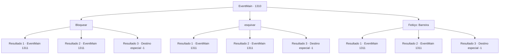

# Eventos principais · 1310

[Índice da tabela](index.md) · [Índice geral](../index.md)

ID: `pt:EventMain:1310` · Fonte: `EventMain4` · Versão: 1.2.47.

Mapeamento estático dos arquivos; a disponibilidade e a execução dependem do estado da run.

## Texto do evento

*Sem texto no arquivo.*

## Dados de entrada

```json
{
  "id": 1310,
  "grade": 1,
  "normalGoal": "",
  "required": ""
}
```

## Mapa das escolhas



## Escolhas e resultados

### Escolha 1

Bloquear

Requisitos e outros campos da escolha:

```json
{
  "required": "20_0_9"
}
```

#### Resultado 1.1

Algo voa em sua direção desde a escuridão. Você rapidamente se protege, afasta-se e encara a assassina. A máscara oculta o rosto, mas, a julgar pelas orelhas pontudas, pela pele escura e fria e pela silhueta esguia, você supõe que seja uma elfa das trevas. Você espreita sua cama. Percebe uma adaga de formato estranho cravada no travesseiro. A assassina puxa outra adaga. Então, algo brilha no canto do seu campo de visão. Você rapidamente se esquiva do ataque dela e recupera o equilíbrio. Outra assassina surge das sombras. As duas assassinas trocam um olhar e começam a atacá-lo por ambos os lados.

Continuação registrada: [Evento 1311](1311.md) na mesma tabela.

```json
{
  "required": "",
  "chance": "1|0_13_1",
  "nextEvent": 1311,
  "type": 0,
  "reward": "6_3_203",
  "place": 10
}
```

#### Resultado 1.2

Algo voa em sua direção desde a escuridão. Você se protege rapidamente, mas não foi rápido o suficiente. Uma lâmina de aço frio roça seu braço esquerdo. Você rola para fora da cama para criar distância. Você recupera o fôlego e se vira para encarar a assassina. A máscara oculta o rosto, mas a julgar pelas orelhas pontudas, pele escura e fria e corpo esbelto, você supõe que seja uma elfa sombria. Você espia sua cama. Você nota uma adaga de formato estranho cravada no travesseiro. A assassina puxa outra adaga. Então, algo brilha na beira do seu campo de visão. Você rapidamente se abaixa para evitar o ataque dela e recupera o equilíbrio. Outra assassina surge das sombras. As duas assassinas trocam olhares e começam a atacá-lo pelos dois lados.

Continuação registrada: [Evento 1311](1311.md) na mesma tabela.

```json
{
  "required": "1_0_2",
  "chance": "18",
  "nextEvent": 1311,
  "type": 1,
  "reward": "0_0_-1|6_3_203",
  "place": 10
}
```

#### Resultado 1.3

Algo voa na sua direção vindo da escuridão. Você se protege rapidamente, mas não é rápido o suficiente. Aço frio perfura seu pescoço e sangue vermelho jorra da ferida. Você se vira para verificar o rosto do assassino. Mas sua consciência se desvanece na escuridão.

Continuação registrada: [Destino especial `-1`](../destinos-especiais.md).

```json
{
  "required": "2_0_2",
  "chance": "18",
  "nextEvent": -1,
  "type": 1,
  "reward": "0_0_-1|15_7_11|25_8_1"
}
```

### Escolha 2

esquivar

Requisitos e outros campos da escolha:

```json
{
  "required": ""
}
```

#### Resultado 2.1

Algo voa em sua direção desde a escuridão. Você rapidamente se protege, afasta-se e encara a assassina. A máscara oculta o rosto, mas, a julgar pelas orelhas pontudas, pela pele escura e fria e pela silhueta esguia, você supõe que seja uma elfa das trevas. Você espreita sua cama. Percebe uma adaga de formato estranho cravada no travesseiro. A assassina puxa outra adaga. Então, algo brilha no canto do seu campo de visão. Você rapidamente se esquiva do ataque dela e recupera o equilíbrio. Outra assassina surge das sombras. As duas assassinas trocam um olhar e começam a atacá-lo por ambos os lados.

Continuação registrada: [Evento 1311](1311.md) na mesma tabela.

```json
{
  "required": "",
  "chance": "1|0_6_1",
  "nextEvent": 1311,
  "type": 0,
  "reward": "6_3_203",
  "place": 10
}
```

#### Resultado 2.2

Algo voa em sua direção desde a escuridão. Você se protege rapidamente, mas não foi rápido o suficiente. Uma lâmina de aço frio roça seu braço esquerdo. Você rola para fora da cama para criar distância. Você recupera o fôlego e se vira para encarar a assassina. A máscara oculta o rosto, mas a julgar pelas orelhas pontudas, pele escura e fria e corpo esbelto, você supõe que seja uma elfa sombria. Você espia sua cama. Você nota uma adaga de formato estranho cravada no travesseiro. A assassina puxa outra adaga. Então, algo brilha na beira do seu campo de visão. Você rapidamente se abaixa para evitar o ataque dela e recupera o equilíbrio. Outra assassina surge das sombras. As duas assassinas trocam olhares e começam a atacá-lo pelos dois lados.

Continuação registrada: [Evento 1311](1311.md) na mesma tabela.

```json
{
  "required": "1_0_2",
  "chance": "20",
  "nextEvent": 1311,
  "type": 1,
  "reward": "0_0_-1|6_3_203",
  "place": 10
}
```

#### Resultado 2.3

Algo voa na sua direção vindo da escuridão. Você se protege rapidamente, mas não é rápido o suficiente. Aço frio perfura seu pescoço e sangue vermelho jorra da ferida. Você se vira para verificar o rosto do assassino. Mas sua consciência se desvanece na escuridão.

Continuação registrada: [Destino especial `-1`](../destinos-especiais.md).

```json
{
  "required": "2_0_2",
  "chance": "20",
  "nextEvent": -1,
  "type": 1,
  "reward": "0_0_-1|15_7_11|25_8_1"
}
```

### Escolha 3

Feitiço: Barreira

Requisitos e outros campos da escolha:

```json
{
  "required": "20_0_1"
}
```

#### Resultado 3.1

Algo voa em sua direção vindo da escuridão. Você rapidamente conjura Barreira para bloquear o ataque, cria distância e se vira para olhar a assassina. A máscara oculta o rosto, mas a julgar pelas orelhas pontudas, pele escura e fria e figura esguia, você supõe que se trata de uma elfa negra. Você espreita sua cama. Você percebe uma adaga de formato estranho cravada no travesseiro. A assassina saca outra adaga. Então, algo brilha na ponta do seu campo de visão. Você rapidamente esquiva do ataque dela e se recompõe. Outra assassina surge das sombras. As duas assassinas trocam um olhar e começam a atacá-lo por ambos os lados.

Continuação registrada: [Evento 1311](1311.md) na mesma tabela.

```json
{
  "required": "",
  "chance": "1|0_7_1",
  "nextEvent": 1311,
  "type": 0,
  "reward": "6_3_203",
  "place": 10
}
```

#### Resultado 3.2

Algo voa em sua direção desde a escuridão. Você se protege rapidamente, mas não foi rápido o suficiente. Uma lâmina de aço frio roça seu braço esquerdo. Você rola para fora da cama para criar distância. Você recupera o fôlego e se vira para encarar a assassina. A máscara oculta o rosto, mas a julgar pelas orelhas pontudas, pele escura e fria e corpo esbelto, você supõe que seja uma elfa sombria. Você espia sua cama. Você nota uma adaga de formato estranho cravada no travesseiro. A assassina puxa outra adaga. Então, algo brilha na beira do seu campo de visão. Você rapidamente se abaixa para evitar o ataque dela e recupera o equilíbrio. Outra assassina surge das sombras. As duas assassinas trocam olhares e começam a atacá-lo pelos dois lados.

Continuação registrada: [Evento 1311](1311.md) na mesma tabela.

```json
{
  "required": "1_0_2",
  "chance": "20",
  "nextEvent": 1311,
  "type": 1,
  "reward": "0_0_-1|6_3_203",
  "place": 10
}
```

#### Resultado 3.3

Algo voa na sua direção vindo da escuridão. Você se protege rapidamente, mas não é rápido o suficiente. Aço frio perfura seu pescoço e sangue vermelho jorra da ferida. Você se vira para verificar o rosto do assassino. Mas sua consciência se desvanece na escuridão.

Continuação registrada: [Destino especial `-1`](../destinos-especiais.md).

```json
{
  "required": "2_0_2",
  "chance": "20",
  "nextEvent": -1,
  "type": 1,
  "reward": "0_0_-1|15_7_11|25_8_1"
}
```

## Referências que chegam a este evento

- [Evento 1302 · escolha 2 · resultado 1](1302.md#escolha-2)
- [Evento 1308 · escolha 2 · resultado 1](1308.md#escolha-2)
