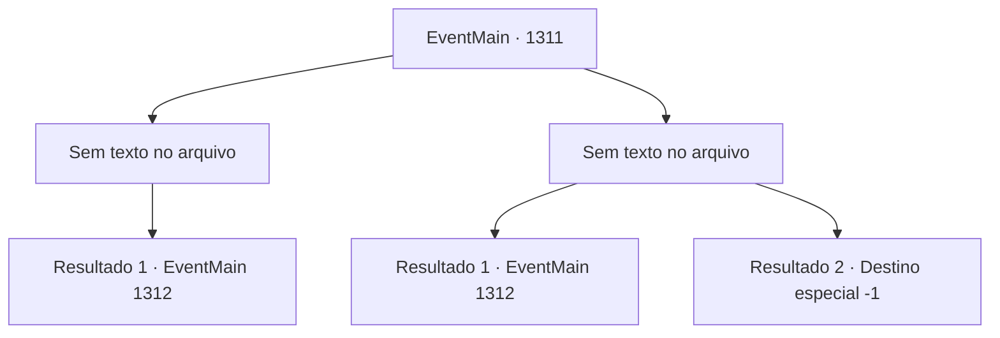

# Eventos principais · 1311

[Índice da tabela](index.md) · [Índice geral](../index.md)

ID: `pt:EventMain:1311` · Fonte: `EventMain4` · Versão: 1.2.47.

Mapeamento estático dos arquivos; a disponibilidade e a execução dependem do estado da run.

## Texto do evento

*Sem texto no arquivo.*

## Dados de entrada

```json
{
  "id": 1311,
  "grade": 1,
  "normalGoal": "",
  "required": ""
}
```

## Mapa das escolhas



## Escolhas e resultados

### Escolha 1

*Sem texto no arquivo; o papel dessa opção depende da interface do jogo.*

Requisitos e outros campos da escolha:

```json
{
  "required": ""
}
```

#### Resultado 1.1

Você derrota os assassinos. Um já caiu. O outro está sentado no chão, vomitando sangue. Você se aproxima dela, mas então ouve algo estalar dentro da sua boca, e ela começa a espumar. O corpo da assassina treme e depois fica fraco. 

 "...Meu Senhor! O senhor está bem?"

 Então, a porta do seu quarto se abre enquanto Rennart e soldados invadem. Você acena com a cabeça e aponta para a assassina morta no chão. Rennart olha para baixo e responde. 

 "Os vigias não estavam em suas posições, então vim verificar... e eles já estavam mortos."

 A testa de Rennart se contrai. Ele olha para o posto da Aliança e continua. 

 "Vou posicionar mais guardas pela área."

 Você desvia o olhar dos assassinos mortos e olha para a janela. As luzes do posto da Aliança tremeluzem ao longe.

Continuação registrada: [Evento 1312](1312.md) na mesma tabela.

```json
{
  "required": "",
  "chance": "1",
  "nextEvent": 1312,
  "type": 2,
  "reward": ""
}
```

### Escolha 2

*Sem texto no arquivo; o papel dessa opção depende da interface do jogo.*

Requisitos e outros campos da escolha:

```json
{
  "required": ""
}
```

#### Resultado 2.1

A lâmina do assassino é cravada em seu corpo. Você é trazido de joelhos, ao chão. 

 "...Meu Senhor! Está tudo bem?"

 Então, a porta do seu quarto se abre quando Rennart e soldados invadem. Os assassinos rapidamente se viram e pulam pelas janelas. Rennart empunha seu arco e dispara uma flecha em suas costas. 

 "Ack...!"

 Mas eles já conseguiram sair, desaparecendo na escuridão. Rennart olha para fora e continua. 

 "Os vigias não estavam em suas posições, então vim verificar... e eles já estavam mortos."

 A testa de Rennart fica protuberante. Ele olha para o posto avançado da Aliança e continua. 

 "Vou posicionar mais guardas pela área."

 Você desvia o olhar dos assassinos mortos e olha para a janela. As luzes do posto avançado da Aliança piscam ao longe.

Continuação registrada: [Evento 1312](1312.md) na mesma tabela.

```json
{
  "required": "1_0_2|1_1_2",
  "chance": "1",
  "nextEvent": 1312,
  "type": 2,
  "reward": "0_0_-1|0_1_-1"
}
```

#### Resultado 2.2

A lâmina do assassino é cravada em seu corpo. Você é trazido de joelhos ao chão. O assassino elfo sombrio se aproxima de você e apunhala seu pescoço.

Continuação registrada: [Destino especial `-1`](../destinos-especiais.md).

```json
{
  "required": "-1|2_0_2|2_1_2",
  "chance": "1",
  "nextEvent": -1,
  "type": 2,
  "reward": "0_0_-1|0_1_-1|15_7_11|25_8_1"
}
```

## Referências que chegam a este evento

- [Evento 1310 · escolha 1 · resultado 1](1310.md#escolha-1)
- [Evento 1310 · escolha 1 · resultado 2](1310.md#escolha-1)
- [Evento 1310 · escolha 2 · resultado 1](1310.md#escolha-2)
- [Evento 1310 · escolha 2 · resultado 2](1310.md#escolha-2)
- [Evento 1310 · escolha 3 · resultado 1](1310.md#escolha-3)
- [Evento 1310 · escolha 3 · resultado 2](1310.md#escolha-3)
