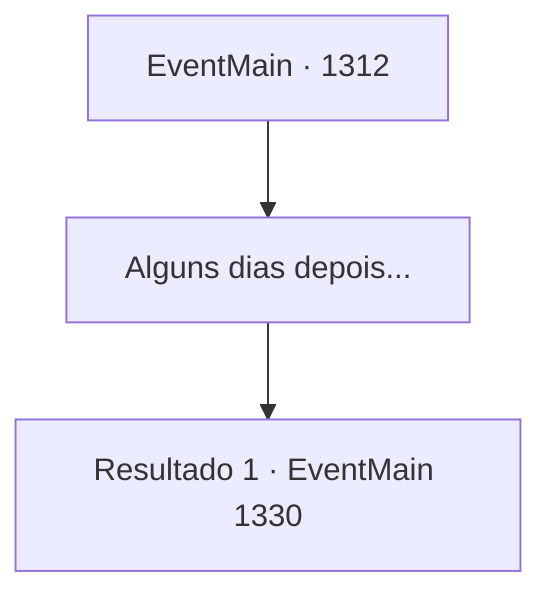

# Eventos principais · 1312

[Índice da tabela](index.md) · [Índice geral](../index.md)

ID: `pt:EventMain:1312` · Fonte: `EventMain4` · Versão: 1.2.47.

Mapeamento estático dos arquivos; a disponibilidade e a execução dependem do estado da run.

## Texto do evento

*Sem texto no arquivo.*

## Dados de entrada

```json
{
  "id": 1312,
  "grade": 1,
  "normalGoal": "",
  "required": ""
}
```

## Mapa das escolhas



## Escolhas e resultados

### Escolha 1

Alguns dias depois...

Requisitos e outros campos da escolha:

```json
{
  "required": ""
}
```

#### Resultado 1.1

Alguns dias depois, você está em seu escritório, recebendo um relatório de Rennart. 

 "Detectamos movimentação da Aliança, tentando fortificar o posto avançado."

 Rennart abre um mapa, então aponta para vários pontos ao redor do posto. 

 "Alguns de nossos batedores encontraram trincheiras sendo escavadas nas bordas."

 Rennart bebe um pouco de água e continua. 

 "Eles também estão importando recursos e rações de fora. Parece que estão se preparando para um cerco prolongado."

 Rennart menciona o estoque de suprimentos dentro do castelo, acrescentando que quanto mais a guerra se prolongar, mais difícil será para você vencer.

Continuação registrada: [Evento 1330](1330.md) na mesma tabela.

```json
{
  "required": "",
  "chance": "1",
  "nextEvent": 1330,
  "type": 2,
  "reward": ""
}
```

## Referências que chegam a este evento

- [Evento 1311 · escolha 1 · resultado 1](1311.md#escolha-1)
- [Evento 1311 · escolha 2 · resultado 1](1311.md#escolha-2)
