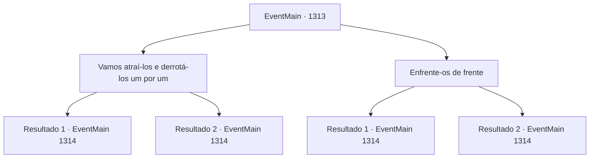

# Eventos principais · 1313

[Índice da tabela](index.md) · [Índice geral](../index.md)

ID: `pt:EventMain:1313` · Fonte: `EventMain4` · Versão: 1.2.47.

Mapeamento estático dos arquivos; a disponibilidade e a execução dependem do estado da run.

## Texto do evento

*Sem texto no arquivo.*

## Dados de entrada

```json
{
  "id": 1313,
  "grade": 1,
  "normalGoal": "",
  "required": ""
}
```

## Mapa das escolhas



## Escolhas e resultados

### Escolha 1

Vamos atraí-los e derrotá-los um por um

Requisitos e outros campos da escolha:

```json
{
  "required": ""
}
```

#### Resultado 1.1

Você ordena atraí‑los para dentro da fortaleza e derrotá‑los um a um. Rennart obedece à sua ordem e rapidamente vai mover seus homens. Enquanto soldados são posicionados ao redor do edifício, inimigos atacam a porta da frente. 

 *crack*... *slash*.... *BANG* 

 Ai de nós, a porta da frente se arromba. Soldados da Aliança invadem, e você os atrai para os telhados. 

 "LÁ! PEGUEM-OS! ELES ESTÃO INDO PARA OS TELHADOS!"

 Você sobe as escadas e corre pelo corredor para atrair os soldados da Aliança. Quando a Aliança o persegue, soldados posicionados de Briovich saem para flanquear. Quando os inimigos mudam de direção para evitar os soldados, você aparece diante deles novamente, e isso leva os soldados da Aliança cada vez mais para dentro da fortaleza. 

 "EMBOSCADA!"

 Mas mesmo isso não é suficiente para derrotar todos os soldados da Aliança. Um cavaleiro de meia‑idade brandindo sua espada longa e esquadrões inteiros de soldados caem a cada golpe. 

 "Acho que já está na hora de você desistir."

 Você sabe o nome dele. Sir Wojciech. Um cavaleiro leal a Katrin, que serviu à Casa Greymoor desde o governo de seu pai. Em vez de responder, você se prepara para lutar com ele. Wojciech responde erguendo sua espada longa e olha para você. 

 "Lá vou eu."

 Então, ele investe contra você como um raio.

Continuação registrada: [Evento 1314](1314.md) na mesma tabela.

```json
{
  "required": "",
  "chance": "1|0_6_1|0_12_1",
  "nextEvent": 1314,
  "type": 0,
  "reward": "6_0_205",
  "place": 10
}
```

#### Resultado 1.2

Você ordena que os atraíam para dentro da fortaleza e os derrotassem um a um. Rennart obedece sua ordem e rapidamente vai posicionar seus homens. Enquanto soldados são posicionados ao redor do prédio, inimigos atacam a porta da frente. 

 *crack*... *slash*.... *BANG* 

 Ai de nós, a porta da frente arromba. Soldados da Aliança invadem, e você os atrai para os telhados. 

 "ALÍ! PEGUEM-OS! ELES VÃO PARA OS TELHADOS!"

 Você sobe as escadas e corre pelo corredor para atrair os soldados da Aliança. Mas o comandante que lidera os soldados da Aliança não cai na armadilha. 

 "É uma armadilha! Não caiam no emboscada deles!"

 Os soldados da Aliança ouvem isso e se agrupam, andando com cuidado e examinando cada canto. Soldados escondidos são avistados um por um, e seu plano falha. Logo, um cavaleiro de meia-idade se aproxima, liderando seus soldados. 

 "Acho que já é hora de vocês desistirem."

 Você sabe o nome dele. Sir Wojciech. Um cavaleiro leal a Katrin, que serve à Casa Greymoor desde o governo de seu pai. Em vez de responder, você se prepara para enfrentá-lo. Wojciech responde levantando sua espada longa e olha para você. 

 "Aqui vou eu."

 Então, ele investe contra você como um relâmpago.

Continuação registrada: [Evento 1314](1314.md) na mesma tabela.

```json
{
  "required": "",
  "chance": "24",
  "nextEvent": 1314,
  "type": 1,
  "reward": "6_3_205",
  "place": 10
}
```

### Escolha 2

Enfrente-os de frente

Requisitos e outros campos da escolha:

```json
{
  "required": ""
}
```

#### Resultado 2.1

Você sugere confrontá-los de frente, por trás da porta da frente. Rennart acena em concordância, posiciona seus soldados e se junta a eles pessoalmente. 

 "ARREMESSEM A PORTA!!"

 Soldados da Aliança golpeiam e atacam a porta da frente com seus machados e maças. Logo, a porta da frente se quebra, e a Aliança invade em massa. 

 "Eles estão entrando! Parem-nos!"

 Segue uma luta terrível. Você e seus soldados defendem-se desesperadamente contra a Aliança. Eles também empregam medidas igualmente desesperadas para conseguir entrar. 

 *crac*... *corte*.... *BUM* 

 Ai, a porta da fortaleza desaba completamente. Mas isso por si só é um progresso notável, já que a Aliança perdeu tanta mão de obra apenas tentando entrar. Um cavaleiro de meia-idade avança e fala. 

 "Acho que já é hora de você desistir."

 Você conhece seu nome. Sir Wojciech. Um cavaleiro leal a Katrin, que serviu à Casa Greymoor desde o governo de seu pai. Em vez de responder, você se prepara para enfrentá-lo. Wojciech responde erguendo sua espada longa e olhando para você. 

 "Aqui vou eu."

 Então, ele investe contra você como um relâmpago.

Continuação registrada: [Evento 1314](1314.md) na mesma tabela.

```json
{
  "required": "",
  "chance": "1|0_13_1|0_12_1",
  "nextEvent": 1314,
  "type": 0,
  "reward": "6_0_205",
  "place": 10
}
```

#### Resultado 2.2

Você sugere confrontá-los de frente, por trás da porta da frente. Rennart acena em concordância, posiciona seus soldados e se junta a eles pessoalmente. 

 "ARREMESSEM A PORTA!!"

 Soldados da Aliança golpeiam e atacam a porta da frente com seus machados e maças. Logo, a porta da frente se quebra, e a Aliança invade em massa. 

 "Eles estão entrando! Parem-nos!"

 Segue uma luta terrível. Você e seus soldados defendem-se desesperadamente contra a Aliança. Eles também empregam medidas igualmente desesperadas para conseguir entrar. 

 *crac*... *corte*.... *BUM* 

 Ai, a porta da fortaleza desaba completamente. Mas isso por si só é um progresso notável, já que a Aliança perdeu tanta mão de obra apenas tentando entrar. Um cavaleiro de meia-idade avança e fala. 

 "Acho que já é hora de você desistir."

 Você conhece seu nome. Sir Wojciech. Um cavaleiro leal a Katrin, que serviu à Casa Greymoor desde o governo de seu pai. Em vez de responder, você se prepara para enfrentá-lo. Wojciech responde erguendo sua espada longa e olhando para você. 

 "Aqui vou eu."

 Então, ele investe contra você como um relâmpago.

Continuação registrada: [Evento 1314](1314.md) na mesma tabela.

```json
{
  "required": "",
  "chance": "24",
  "nextEvent": 1314,
  "type": 1,
  "reward": "6_3_205",
  "place": 10
}
```

## Referências que chegam a este evento

- [Evento 1300 · escolha 2 · resultado 1](1300.md#escolha-2)
- [Evento 1325 · escolha 2 · resultado 1](1325.md#escolha-2)
