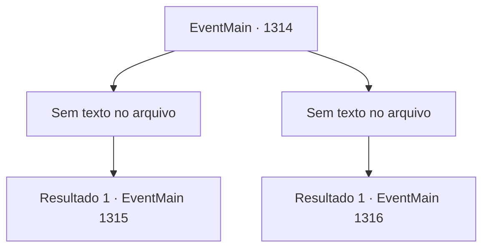

# Eventos principais · 1314

[Índice da tabela](index.md) · [Índice geral](../index.md)

ID: `pt:EventMain:1314` · Fonte: `EventMain4` · Versão: 1.2.47.

Mapeamento estático dos arquivos; a disponibilidade e a execução dependem do estado da run.

## Texto do evento

*Sem texto no arquivo.*

## Dados de entrada

```json
{
  "id": 1314,
  "grade": 1,
  "normalGoal": "",
  "required": ""
}
```

## Mapa das escolhas



## Escolhas e resultados

### Escolha 1

*Sem texto no arquivo; o papel dessa opção depende da interface do jogo.*

Requisitos e outros campos da escolha:

```json
{
  "required": ""
}
```

#### Resultado 1.1

Sir Wojciech avança contra você com um estrondoso grito de batalha. Você pega uma espada por perto e a enfia em seu peito. 

 "Argh--!"

 Você sente algo bater contra sua empunhadura. Você torce a espada e a arranca. Wojciech encara você sem reação antes de cair no chão. Você carrega seu corpo inerte nos ombros e segue para o salão principal. Lá, você joga o corpo de Sir Wojciech diante do restante da Aliança. 

 "S- SIR WOJCIECH CAIU!"

 O pânico se espalha entre os soldados. Você aproveita a oportunidade e ordena aos seus homens que ataquem. Soldados de Briovich irrompem, e a Aliança é lentamente empurrada cada vez mais para trás. Quando sua formação se quebra, os soldados da Aliança começam a virar as costas e fugir. Você conduz seus soldados contornando-os, expulsando a Aliança do castelo. Mas sua vitória teve um custo alto. As muralhas do castelo e o torreão estão reduzidos a cinzas, sem falar no enorme número de mortos. 

 "...Vencemos, meu senhor."

 Você se vira e vê Rennart mancando em sua direção.

Continuação registrada: [Evento 1315](1315.md) na mesma tabela.

```json
{
  "required": "",
  "chance": "1",
  "nextEvent": 1315,
  "type": 2,
  "reward": ""
}
```

### Escolha 2

*Sem texto no arquivo; o papel dessa opção depende da interface do jogo.*

Requisitos e outros campos da escolha:

```json
{
  "required": ""
}
```

#### Resultado 2.1

Infelizmente, Sir Wojciech o derrota. Ele chuta sua arma para fora do seu alcance e então dá ordens aos seus homens. 

 "Corram com este e o acorrentem."

 Seus braços são amarrados nas costas e você é arrastado para fora da fortaleza. A batalha aproxima-se do fim. Seus soldados posicionados ao redor do edifício como emboscadas são descobertos um a um, alguns largam suas armas e se rendem. 

 "Meu Senhor..."

 Rennart também é trazido de joelhos, agarrado por muitos soldados. 

 Alguns dias depois, você está amarrado e enviado ao Castelo Greymoor. Katrin e mais alguns nobres já o aguardam no gabinete. 

 "Condessa Greymoor, como pretende lidar com Briovich?"

 Katrin responde lentamente. 

 "O crime de abrigar um necromante é grave. A lei determina que eu envie este caso ao tribunal real."

 Ela olha ao redor dos nobres e continua. 

 "Mas, não podemos deixar assim, podemos? Nós derramamos todo esse sangue e não recebemos nada em troca por tudo isso?"

 Ela coloca um documento sobre a mesa. Escrito nele há um contrato, cujos termos tiram a maior parte dos seus direitos sobre suas propriedades, deixando nada além do seu título de nobreza. 

 "Agora, você poderia assinar este contrato para mim?"


Continuação registrada: [Evento 1316](1316.md) na mesma tabela.

```json
{
  "required": "",
  "chance": "1",
  "nextEvent": 1316,
  "type": 2,
  "reward": ""
}
```

## Referências que chegam a este evento

- [Evento 1313 · escolha 1 · resultado 1](1313.md#escolha-1)
- [Evento 1313 · escolha 1 · resultado 2](1313.md#escolha-1)
- [Evento 1313 · escolha 2 · resultado 1](1313.md#escolha-2)
- [Evento 1313 · escolha 2 · resultado 2](1313.md#escolha-2)
