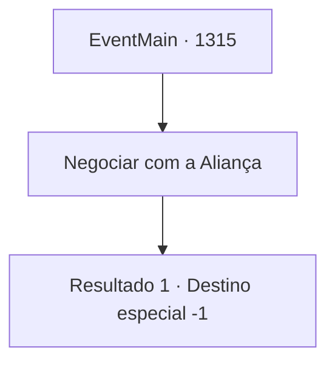

# Eventos principais · 1315

[Índice da tabela](index.md) · [Índice geral](../index.md)

ID: `pt:EventMain:1315` · Fonte: `EventMain4` · Versão: 1.2.47.

Mapeamento estático dos arquivos; a disponibilidade e a execução dependem do estado da run.

## Texto do evento

*Sem texto no arquivo.*

## Dados de entrada

```json
{
  "id": 1315,
  "grade": 1,
  "normalGoal": "",
  "required": ""
}
```

## Mapa das escolhas



## Escolhas e resultados

### Escolha 1

Negociar com a Aliança

Requisitos e outros campos da escolha:

```json
{
  "required": ""
}
```

#### Resultado 1.1

Você olha para o céu. Logo, o céu fica nublado e começa a chover. Você olha lentamente ao redor das ruínas do castelo e finalmente decide acabar com a guerra. 

 A negociação ocorre muito rapidamente. Os nobres da Aliança concordaram em lhe pagar uma indenização pela guerra. Um tratado de paz mútuo entre os dois lados é assinado. Você embarca em uma diligência e retorna ao Castelo Briovich. O castelo está arruinado além do reconhecimento. 

 "Vou verificar os outros castelos da propriedade e as vilas assim que possível."

 Você acena em resposta, observando os moradores da propriedade. Você lê cansaço e preocupação em seus rostos, mas com lampejos de esperança aqui e ali. Mas você saiu vitorioso. Ninguém poderia duvidar disso.

Continuação registrada: [Destino especial `-1`](../destinos-especiais.md).

```json
{
  "required": "",
  "chance": "1",
  "nextEvent": -1,
  "type": 2,
  "reward": "15_7_19"
}
```

## Referências que chegam a este evento

- [Evento 1314 · escolha 1 · resultado 1](1314.md#escolha-1)
