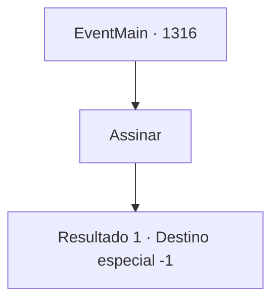

# Eventos principais · 1316

[Índice da tabela](index.md) · [Índice geral](../index.md)

ID: `pt:EventMain:1316` · Fonte: `EventMain4` · Versão: 1.2.47.

Mapeamento estático dos arquivos; a disponibilidade e a execução dependem do estado da run.

## Texto do evento

*Sem texto no arquivo.*

## Dados de entrada

```json
{
  "id": 1316,
  "grade": 1,
  "normalGoal": "",
  "required": ""
}
```

## Mapa das escolhas



## Escolhas e resultados

### Escolha 1

Assinar

Requisitos e outros campos da escolha:

```json
{
  "required": ""
}
```

#### Resultado 1.1

Você assina o contrato. Katrin derrama um pouco de cera de vela no pergaminho, pressionando o sigilo de Greymoor nele. Os outros nobres seguem o exemplo, com os sigilos de suas próprias Casas. Então, ela aponta para a parte inferior do documento. 

 "Aqui mesmo."

 Você acompanha e carimba o sigilo de Briovich nele. Um contrato oficial foi assinado. Katrin pega o contrato e fala calmamente. 

 "Desejo a você um retorno seguro. Enviarei um mordomo em alguns dias."

 Você deixa o Castelo Greymoor. O caminho de volta ao Solar Briovich parece bem mais longo do que o habitual. Você conseguiu proteger seu título, mas isso foi tudo.

Continuação registrada: [Destino especial `-1`](../destinos-especiais.md).

```json
{
  "required": "",
  "chance": "1",
  "nextEvent": -1,
  "type": 2,
  "reward": "15_7_2"
}
```

## Referências que chegam a este evento

- [Evento 1314 · escolha 2 · resultado 1](1314.md#escolha-2)
- [Evento 1329 · escolha 1 · resultado 1](1329.md#escolha-1)
