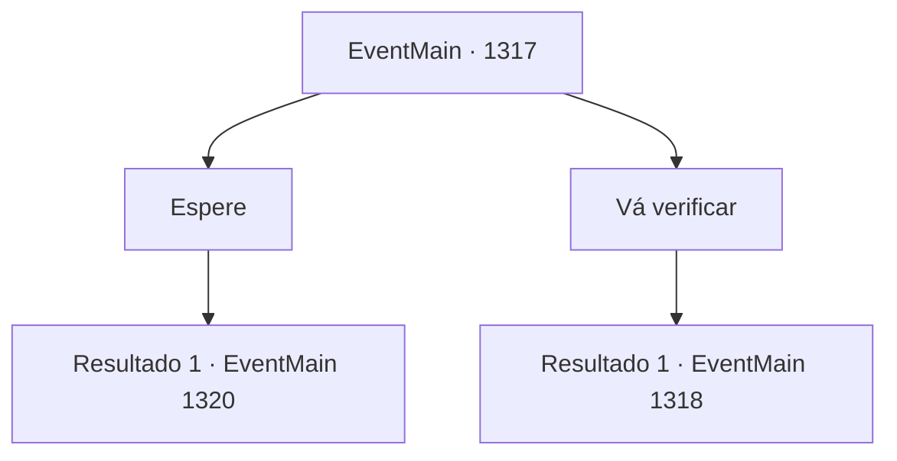

# Eventos principais · 1317

[Índice da tabela](index.md) · [Índice geral](../index.md)

ID: `pt:EventMain:1317` · Fonte: `EventMain4` · Versão: 1.2.47.

Mapeamento estático dos arquivos; a disponibilidade e a execução dependem do estado da run.

## Texto do evento

*Sem texto no arquivo.*

## Dados de entrada

```json
{
  "id": 1317,
  "grade": 1,
  "normalGoal": "",
  "required": ""
}
```

## Mapa das escolhas



## Escolhas e resultados

### Escolha 1

Espere

Requisitos e outros campos da escolha:

```json
{
  "required": ""
}
```

#### Resultado 1.1

Você mantém o olhar no campo de batalha e decide esperar um pouco mais. Logo, guardas correm para dentro do escritório. 

 "M- Meu Senhor! Inimigos estão entrando!"

 Você volta o olhar para encontrar um exército de cavaleiros avançando em sua direção. Você nota bandeiras de muitas Casas diferentes, incluindo a da Casa Greymoor. Mais exércitos seguem atrás da cavalaria, marchando em uma velocidade igualmente rápida. 

 "LÁ! ALI!!"

 "PEGUEM!!"

 A cavalaria é rápido demais para você fugir. Você reúne seus homens, saca sua arma e lidera a investida contra o inimigo.

Continuação registrada: [Evento 1320](1320.md) na mesma tabela.

```json
{
  "required": "",
  "chance": "1",
  "nextEvent": 1320,
  "type": 2,
  "reward": "6_0_204",
  "place": 0
}
```

### Escolha 2

Vá verificar

Requisitos e outros campos da escolha:

```json
{
  "required": ""
}
```

#### Resultado 2.1

Você deixa os engenheiros militares para trás, para destruir as barragens quando chegar a hora, e segue para o campo de batalha com o resto dos seus soldados. 

 É um caos total no campo de batalha. Você percebe bandeiras de muitas Casas diferentes, incluindo a da Casa Greymoor. Soldados de Briovich estão cercados por cavaleiros de várias Casas. Rennart também está lá lutando por sua vida, mas a maré da batalha não pode ser mudada por ele sozinho. 

 "Meu Senhor! Nossos aliados estão sendo atacados!"

 Um soldado olhando para a batalha grita. Você acena com a cabeça e procura um ponto fraco na formação. Você encontra um lado visivelmente menos protegido na formação - eles parecem estar muito investidos em seus ataques. Você lidera seus homens numa investida, mirando na abertura.

Continuação registrada: [Evento 1318](1318.md) na mesma tabela.

```json
{
  "required": "",
  "chance": "1",
  "nextEvent": 1318,
  "type": 2,
  "reward": "6_0_204",
  "place": 0
}
```

## Referências que chegam a este evento

- [Evento 1291 · escolha 2 · resultado 1](1291.md#escolha-2)
