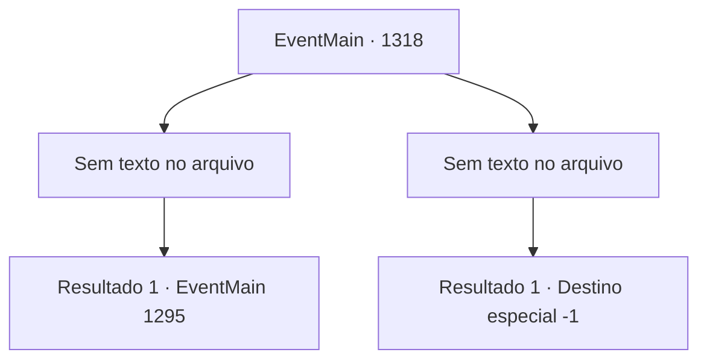

# Eventos principais · 1318

[Índice da tabela](index.md) · [Índice geral](../index.md)

ID: `pt:EventMain:1318` · Fonte: `EventMain4` · Versão: 1.2.47.

Mapeamento estático dos arquivos; a disponibilidade e a execução dependem do estado da run.

## Texto do evento

*Sem texto no arquivo.*

## Dados de entrada

```json
{
  "id": 1318,
  "grade": 1,
  "normalGoal": "",
  "required": ""
}
```

## Mapa das escolhas



## Escolhas e resultados

### Escolha 1

*Sem texto no arquivo; o papel dessa opção depende da interface do jogo.*

Requisitos e outros campos da escolha:

```json
{
  "required": ""
}
```

#### Resultado 1.1


 "ALI! PEGUEM-OS! NÃO DEIXEM ELES FUGIREM!"

 Os cavaleiros da Aliança correm uns contra os outros para alcançá-lo assim que o avistam. Você guia rapidamente seu cavalo, atraindo os inimigos e dando tempo aos seus companheiros para recuar. Eventualmente, você chega ao Rio Kroben. As barragens pré-construídas estão funcionando maravilhosamente. A corrente do rio enfraqueceu. 

 "Ali! Não deixem eles escaparem!"

 "Capturem Briovich!"

 Após confirmar que cada um de seus soldados já passou pelo rio, você puxa seu pergaminho sinalizador. Você rasga o pergaminho ao meio, justo quando os inimigos estão no centro do rio. Uma bola brilhante de luz azul surge no ar. 

 <link=shake>'GRRRRRRRNG!! *RUMBLE*</link> |drawing_washArmy| Logo em seguida, a água aprisionada varre o terreno. Os soldados da Aliança são completamente aniquilados. Mais da metade deles é levada pela água. 

 "A- AJUDA!! ARGH!!"

 Levados pela corrente, os soldados da Aliança perdem o moral. Os que restam estão ocupados correndo por suas vidas, enquanto você e seus homens os perseguem.

Continuação registrada: [Evento 1295](1295.md) na mesma tabela.

```json
{
  "required": "",
  "chance": "1",
  "nextEvent": 1295,
  "type": 2,
  "reward": "6_2_204",
  "place": 0
}
```

### Escolha 2

*Sem texto no arquivo; o papel dessa opção depende da interface do jogo.*

Requisitos e outros campos da escolha:

```json
{
  "required": ""
}
```

#### Resultado 2.1

Um cavaleiro da Aliança aponta a espada para o seu pescoço. Você dá um passo para trás e desvia, mas nesse instante uma lança atravessa seu abdômen. Perfurado pela lança, você é arremessado ao chão. 

 "...MEU SENHOR!!"

 Os gritos de Rennart ecoam pelo campo de batalha. Sua visão fica turva enquanto tudo escurece.

Continuação registrada: [Destino especial `-1`](../destinos-especiais.md).

```json
{
  "required": "",
  "chance": "1",
  "nextEvent": -1,
  "type": 2,
  "reward": "0_0_-1|0_1_-1|15_7_11|25_8_1"
}
```

## Referências que chegam a este evento

- [Evento 1317 · escolha 2 · resultado 1](1317.md#escolha-2)
- [Evento 1319 · escolha 2 · resultado 1](1319.md#escolha-2)
