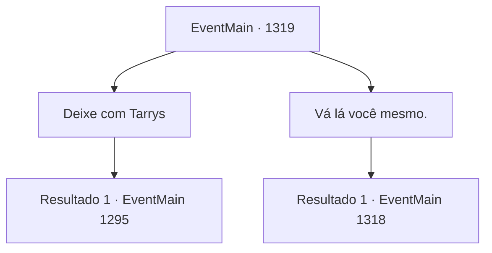

# Eventos principais · 1319

[Índice da tabela](index.md) · [Índice geral](../index.md)

ID: `pt:EventMain:1319` · Fonte: `EventMain4` · Versão: 1.2.47.

Mapeamento estático dos arquivos; a disponibilidade e a execução dependem do estado da run.

## Texto do evento

*Sem texto no arquivo.*

## Dados de entrada

```json
{
  "id": 1319,
  "grade": 1,
  "normalGoal": "",
  "required": ""
}
```

## Mapa das escolhas



## Escolhas e resultados

### Escolha 1

Deixe com Tarrys

Requisitos e outros campos da escolha:

```json
{
  "required": ""
}
```

#### Resultado 1.1


 "Vou vê-lo mais tarde, então, meu senhor."

 Tarrys parte com oito homens, correndo para o campo de batalha. 

 Cerca de duas horas se passam. De repente, uma bola de luz brilhante entra em sua visão. A bola de luz azul explode com um estrondo alto, subindo para o céu. É o sinalizador. 

 "M- MEU SENHOR!"

 Você imediatamente sinaliza aos engenheiros para romperem as represas. Eles pegam suas cordas e alavancas imediatamente e começam a sacudi-las. Logo, as represas racham, e o rio aprisionado começa a fluir novamente. <link=shake>'GRRRRRRRNG!! *RUMBLE*</link> Você confirma o rio correndo violentamente, então conduz seus homens ao campo de batalha. Quando você chega, o destino da batalha já foi decidido. Varredos pelo rio, os soldados da Aliança estão ocupados fugindo. Você lidera seus homens e persegue os soldados sobreviventes da Aliança.

Continuação registrada: [Evento 1295](1295.md) na mesma tabela.

```json
{
  "required": "",
  "chance": "1",
  "nextEvent": 1295,
  "type": 2,
  "reward": "5_958_1|6_2_204",
  "place": 0
}
```

### Escolha 2

Vá lá você mesmo.

Requisitos e outros campos da escolha:

```json
{
  "required": ""
}
```

#### Resultado 2.1

Você deixa Tarrys no lado superior do rio e conduz seus homens ao campo de batalha. Os ruídos da batalha se aproximam à medida que você chega mais perto. 

 É caos total no campo de batalha. Você nota bandeiras de muitas Casas diferentes, incluindo a da Casa Greymoor. Soldados de Briovich estão cercados por cavaleiros de várias Casas. Rennart também está lá lutando por sua vida, mas a maré da batalha não pode ser virada por ele sozinho. 

 "Meu senhor! Nossos aliados estão sendo atacados!"

 Um soldado, olhando para a batalha, grita. Você acena com a cabeça e procura um ponto fraco na formação inimiga. Você encontra um lado visivelmente menos protegido na formação — eles parecem estar muito investidos em seus ataques. Você conduz seus homens em uma carga, mirando na abertura.

Continuação registrada: [Evento 1318](1318.md) na mesma tabela.

```json
{
  "required": "",
  "chance": "1",
  "nextEvent": 1318,
  "type": 2,
  "reward": "6_0_204",
  "place": 0
}
```

## Referências que chegam a este evento

- [Evento 1291 · escolha 2 · resultado 2](1291.md#escolha-2)
