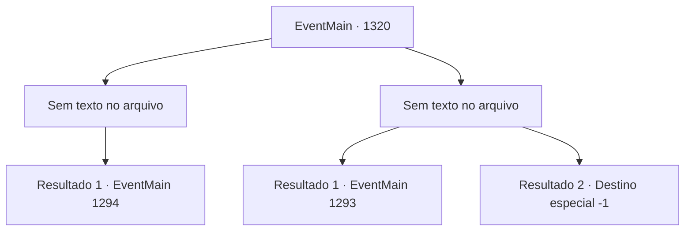

# Eventos principais · 1320

[Índice da tabela](index.md) · [Índice geral](../index.md)

ID: `pt:EventMain:1320` · Fonte: `EventMain4` · Versão: 1.2.47.

Mapeamento estático dos arquivos; a disponibilidade e a execução dependem do estado da run.

## Texto do evento

*Sem texto no arquivo.*

## Dados de entrada

```json
{
  "id": 1320,
  "grade": 1,
  "normalGoal": "",
  "required": ""
}
```

## Mapa das escolhas



## Escolhas e resultados

### Escolha 1

*Sem texto no arquivo; o papel dessa opção depende da interface do jogo.*

Requisitos e outros campos da escolha:

```json
{
  "required": ""
}
```

#### Resultado 1.1

Com grande destreza marcial, você derrota as forças inimigas. Então, você nota um cavalo se aproximando do rio mais abaixo. O soldado a cavalo ofega e se aproxima de você. Você reconhece aquele rosto — é o mensageiro que se juntou a Rennart no esquadrão de isca. 

 "...Meu Senhor! O mordomo pediu reforços de emergência! O esquadrão de isca está cercado pelos inimigos, sem para onde fugir!"

 Ao ouvir a notícia, você deixa os engenheiros para trás, para destruir as represas quando chegar a hora, e segue para o campo de batalha com o restante de seus soldados. 

 É um caos total no campo de batalha. Você nota estandartes de muitas Casas diferentes, incluindo o da Casa Greymoor. Soldados de Briovich estão cercados por cavaleiros de várias Casas. Rennart também está lá lutando pela vida, mas o curso da batalha não pode ser mudado por ele sozinho. 

 "...Meu Senhor!"

 Você rapidamente se junta aos seus homens e abre um caminho de fuga. Mas assim que ele se abre, outro grupo de soldados da Aliança aparece. 

 "Eu, Cedric da Casa Bathory, estou aqui! Tomem minha lâmina!!"

 Uma cavalaria liderada por um cavaleiro da Aliança bloqueia seu caminho.

Continuação registrada: [Evento 1294](1294.md) na mesma tabela.

```json
{
  "required": "",
  "chance": "1",
  "nextEvent": 1294,
  "type": 2,
  "reward": ""
}
```

### Escolha 2

*Sem texto no arquivo; o papel dessa opção depende da interface do jogo.*

Requisitos e outros campos da escolha:

```json
{
  "required": ""
}
```

#### Resultado 2.1

Você luta duro e bem, mas está simplesmente em número muito inferior. Tudo o que você pode fazer é reunir os soldados sobreviventes e fugir. 

 "M- meu senhor! Ali, o sinalizador!"

 Então, uma explosão de luz vermelha aparece no céu. Isso significa que o plano falhou, e a próxima ordem é recuar. Lamentavelmente, você abandona seu plano e recua para o castelo. 

 Dois dias depois, você está em seu escritório, recebendo um relatório de Rennart depois de mal conseguir recuar. O peito e o ombro dele estão enfaixados. Seus olhos estão cansados. 

 "Sinto muito, meu senhor. Mas não tive escolha senão recuar, depois de ficarmos completamente cercados."

 Você balança a cabeça e o desculpa, então pergunta qual deve ser o próximo passo. 

 "A Aliança está marchando para o castelo enquanto falamos."

 Você e Rennart seguem para a praça principal do castelo. Lá, os soldados sobreviventes estão reunidos, cobertos de bandagens e exaustão.

Continuação registrada: [Evento 1293](1293.md) na mesma tabela.

```json
{
  "required": "1_0_2|1_1_2",
  "chance": "1",
  "nextEvent": 1293,
  "type": 2,
  "reward": "0_0_-1|0_1_-1"
}
```

#### Resultado 2.2

Um cavaleiro da Aliança aponta a espada para o seu pescoço. Você dá um passo para trás e desvia, mas naquele instante uma lança perfura seu abdômen. Você para a lança com sua arma, dando outro passo para trás. Mas então, uma flecha vem por trás e perfura sua testa. Você olha para o céu, atônito, antes de cair de cabeça no chão. 

 "...Meu Senhor!!"

 Os gritos de Rennart ecoam pelo campo de batalha. Sua visão fica turva enquanto tudo fica escuro.

Continuação registrada: [Destino especial `-1`](../destinos-especiais.md).

```json
{
  "required": "-1|2_0_2|2_1_2",
  "chance": "1",
  "nextEvent": -1,
  "type": 2,
  "reward": "15_7_11|0_0_-1|0_1_-1|25_8_1"
}
```

## Referências que chegam a este evento

- [Evento 1317 · escolha 1 · resultado 1](1317.md#escolha-1)
