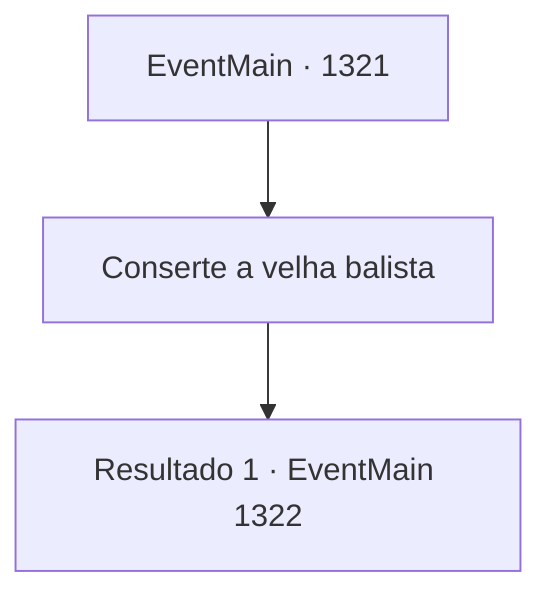

# Eventos principais · 1321

[Índice da tabela](index.md) · [Índice geral](../index.md)

ID: `pt:EventMain:1321` · Fonte: `EventMain4` · Versão: 1.2.47.

Mapeamento estático dos arquivos; a disponibilidade e a execução dependem do estado da run.

## Texto do evento

*Sem texto no arquivo.*

## Dados de entrada

```json
{
  "id": 1321,
  "grade": 1,
  "normalGoal": "",
  "required": ""
}
```

## Mapa das escolhas



## Escolhas e resultados

### Escolha 1

Conserte a velha balista

Requisitos e outros campos da escolha:

```json
{
  "required": ""
}
```

#### Resultado 1.1

Rennart acena com a cabeça e leva você à velha armaria atrás do castelo. Este lugar era usado na época do seu antecessor, mas agora está abandonado. Camadas espessas de poeira cobrem tudo, inclusive a balista quebrada em um canto. Você se aproxima da balista e a esfrega cuidadosamente. Apesar de parecer muito antiga, não mostra sinais visíveis de corrosão ou ferrugem. 

 "Pode parecer perfeitamente normal, mas o mecanismo que suporta a força está quebrado. Se disparássemos um único tiro, isso destruiria a balista."

 Rennart coça o queixo, pensa por alguns segundos e fala. 

 "Claro, há o problema do ouro. Afinal, um dispositivo complexo como este é melhor nas mãos de um especialista. Fiz uma pesquisa rápida, e seriam necessários pelo menos 200 de ouro para repará-la."


Continuação registrada: [Evento 1322](1322.md) na mesma tabela.

```json
{
  "required": "",
  "chance": "1",
  "nextEvent": 1322,
  "type": 2,
  "reward": ""
}
```

## Referências que chegam a este evento

- [Evento 1290 · escolha 2 · resultado 1](1290.md#escolha-2)
