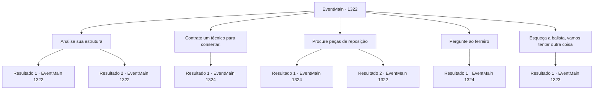

# Eventos principais · 1322

[Índice da tabela](index.md) · [Índice geral](../index.md)

ID: `pt:EventMain:1322` · Fonte: `EventMain4` · Versão: 1.2.47.

Mapeamento estático dos arquivos; a disponibilidade e a execução dependem do estado da run.

## Texto do evento

*Sem texto no arquivo.*

## Dados de entrada

```json
{
  "id": 1322,
  "grade": 1,
  "normalGoal": "",
  "required": ""
}
```

## Mapa das escolhas



## Escolhas e resultados

### Escolha 1

Analise sua estrutura

Requisitos e outros campos da escolha:

```json
{
  "required": "5_964_0"
}
```

#### Resultado 1.1

Você cuidadosamente desmonta toda a balista, examinando sua estrutura. A engrenagem de aço que deveria manter a corda firmemente travada tem três ou quatro dentes completamente lascados. O gatilho, colocado entre cada dente para impedir que a engrenagem gire na direção oposta, está mole como borracha, tendo perdido sua função.

Continuação registrada: [Evento 1322](1322.md) na mesma tabela.

```json
{
  "required": "",
  "chance": "1|0_7_1",
  "nextEvent": 1322,
  "type": 0,
  "reward": "5_964_1"
}
```

#### Resultado 1.2

Você desmonta cuidadosamente toda a balista, tentando examinar sua estrutura. Mas desmontar o próprio aparelho acaba sendo uma tarefa difícil. Você consegue fazê-lo mesmo assim, mas acaba não conseguindo discernir quais peças estão quebradas e quais não estão.

Continuação registrada: [Evento 1322](1322.md) na mesma tabela.

```json
{
  "required": "",
  "chance": "24",
  "nextEvent": 1322,
  "type": 1,
  "reward": "5_964_2"
}
```

### Escolha 2

Contrate um técnico para consertar.

Requisitos e outros campos da escolha:

```json
{
  "required": "1_4_200"
}
```

#### Resultado 2.1

Você ordena a Rennart que convoque os técnicos. Ele procede a vasculhar toda a propriedade e encontra um técnico anão chamado Dorgan. Dorgan dá uma olhada na balista, dá de ombros e fala. 

 "Ah. Aqui - o mecanismo e o gatilho estão quebrados. Vou consertar direitinho em pouco tempo, você poderá usá-la imediatamente."

 Você lhe dá a quantia prometida de ouro, e o técnico anão já começa a trabalhar de imediato. 

 Alguns momentos depois, a balista está instalada nas muralhas do castelo. Você ordena aos seus homens que testem a arma. Quando o soldado gira a manivela, com um estridente guincho, a corda da balista é tensionada. Então, um enorme pedaço de aço é lançado para longe. Rennart vê a balista em funcionamento e sorri. 

 "Esse técnico fez um ótimo trabalho. Parece — e funciona — melhor do que antes!"

 Dorgan afaga a barba e responde. 

 "Claro! Nós anões somos especialistas em maquinaria."


Continuação registrada: [Evento 1324](1324.md) na mesma tabela.

```json
{
  "required": "",
  "chance": "1",
  "nextEvent": 1324,
  "type": 2,
  "reward": "0_4_-200|5_964_3"
}
```

### Escolha 3

Procure peças de reposição

Requisitos e outros campos da escolha:

```json
{
  "required": "5_964_1"
}
```

#### Resultado 3.1

Você decide procurar peças para substituir a engrenagem e o gatilho. Dois itens vêm à sua mente. É a grande roda dentada da torre do relógio no solar, e uma lança com gancho encontrada no arsenal. Você imediatamente ordena que seus homens tragam as engrenagens da torre do relógio e algumas cópias da lança com gancho. Alguns momentos depois, os soldados retornam com os itens. Você cuidadosamente retira a engrenagem de aço empenada e compara o encaixe vazio com as engrenagens da torre do relógio. Felizmente, você encontra uma pequena engrenagem, quase idêntica em largura e ângulo. Você a lubrifica bem e a encaixa na balista. Então, você quebra a ponta da lança com gancho e a martela, tornando-a achatada e sem ponta. Você instala as peças improvisadas no eixo da balista - as duas peças se encaixam apertadas como que por magia. 

 "W- isso realmente vai funcionar...?"

 Rennart encara a balista com um olhar preocupado. Você ordena que seus homens testem a arma. Quando o soldado gira a manivela, com um agudo guincho, a corda da balista é puxada até ficar tensa. Rennart observa a balista em ação e zomba. 

 "Hum. Bem, contanto que funcione, eu acho."


Continuação registrada: [Evento 1324](1324.md) na mesma tabela.

```json
{
  "required": "",
  "chance": "1|0_14_1",
  "nextEvent": 1324,
  "type": 0,
  "reward": "5_964_3"
}
```

#### Resultado 3.2

Você tenta pensar em itens que poderiam substituir a engrenagem e o gatilho, mas nenhum vem à sua mente.

Continuação registrada: [Evento 1322](1322.md) na mesma tabela.

```json
{
  "required": "",
  "chance": "24",
  "nextEvent": 1322,
  "type": 1,
  "reward": "5_964_2"
}
```

### Escolha 4

Pergunte ao ferreiro

Requisitos e outros campos da escolha:

```json
{
  "required": "5_887_1|5_964_1"
}
```

#### Resultado 4.1

Você desenha os projetos dos componentes necessários e segue para a ferraria. Os ferreiros olham para eles e franzem a testa. 

 "Hmm... Esses são designs bastante intrincados... Bem, vamos tentar."

 Eles examinam seus projetos cuidadosamente e começam a fundir ferro. 

 Alguns instantes depois, a balista é instalada nas muralhas do castelo. Você ordena que seus homens testem a arma. Quando o soldado gira a manivela, com um estridente guincho, a corda da balista é tensionada. Então, um enorme pedaço de aço é lançado para bem longe. Rennart vê a balista em ação e sorri. 

 "Nossos ferreiros fizeram um ótimo trabalho. Parece — e se sente — melhor do que antes!"


Continuação registrada: [Evento 1324](1324.md) na mesma tabela.

```json
{
  "required": "",
  "chance": "1",
  "nextEvent": 1324,
  "type": 2,
  "reward": "5_964_3"
}
```

### Escolha 5

Esqueça a balista, vamos tentar outra coisa

Requisitos e outros campos da escolha:

```json
{
  "required": ""
}
```

#### Resultado 5.1

Você decide abandonar a balista e procurar outras maneiras. Rennart pensa por um momento e começa a falar. 

 "Nosso castelo fica numa posição elevada. Podemos usar a altura a nosso favor."

 Rennart puxa um mapa do Castelo Briovich e continua. 

 "Terra, pedras, madeira... Deve haver maneiras de usarmos os recursos dentro da nossa propriedade."

 Rennart pousa a mão nas muralhas do castelo e se vira para você. 

 "Você... tem alguma ideia?"


Continuação registrada: [Evento 1323](1323.md) na mesma tabela.

```json
{
  "required": "",
  "chance": "1",
  "nextEvent": 1323,
  "type": 2,
  "reward": ""
}
```

## Referências que chegam a este evento

- [Evento 1321 · escolha 1 · resultado 1](1321.md#escolha-1)
- [Evento 1322 · escolha 1 · resultado 1](1322.md#escolha-1)
- [Evento 1322 · escolha 1 · resultado 2](1322.md#escolha-1)
- [Evento 1322 · escolha 3 · resultado 2](1322.md#escolha-3)
