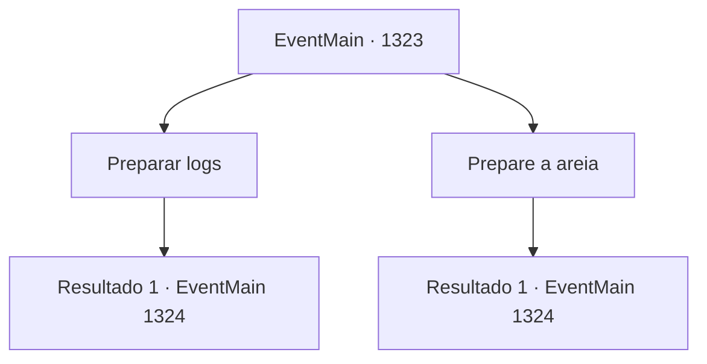

# Eventos principais · 1323

[Índice da tabela](index.md) · [Índice geral](../index.md)

ID: `pt:EventMain:1323` · Fonte: `EventMain4` · Versão: 1.2.47.

Mapeamento estático dos arquivos; a disponibilidade e a execução dependem do estado da run.

## Texto do evento

*Sem texto no arquivo.*

## Dados de entrada

```json
{
  "id": 1323,
  "grade": 1,
  "normalGoal": "",
  "required": ""
}
```

## Mapa das escolhas



## Escolhas e resultados

### Escolha 1

Preparar logs

Requisitos e outros campos da escolha:

```json
{
  "required": ""
}
```

#### Resultado 1.1

Você ordena aos seus homens que recolham toras que possam ser usadas para destruir equipamentos de cerco. Seu plano é preparar as toras e rolá-las todas de uma vez quando os inimigos se aproximarem. Rennart atende ao seu comando e sai do escritório. Imediatamente, ele envia soldados para as Florestas de Almorn, ordenando que cortem freixos e carvalhos. Em um instante, uma clareira dentro das muralhas do castelo é transformada em uma oficina de carpintaria. Seus soldados cortam as toras na proporção adequada e as recheiam com lâminas quebradas e pontas de lança. Depois, são fechadas com uma estaca e penduradas nas muralhas com cordas.

Continuação registrada: [Evento 1324](1324.md) na mesma tabela.

```json
{
  "required": "",
  "chance": "1",
  "nextEvent": 1324,
  "type": 2,
  "reward": "5_965_1"
}
```

### Escolha 2

Prepare a areia

Requisitos e outros campos da escolha:

```json
{
  "required": ""
}
```

#### Resultado 2.1

Você ordena que seus homens recolham areia. Seu plano é aquecer a areia e derramá-la sobre os atacantes. Rennart obedece ao seu comando e sai do escritório. Sob sua liderança, dezenas de fornos improvisados são instalados nos terrenos do castelo. Os soldados trazem cada panela e caldeirão que conseguem encontrar, vasculhando cozinhas e armazéns, e os penduram sobre os fornos. Lenha e madeira que puderam ser encontradas na propriedade são lançadas para alimentar o fogo. Os fornos começam a arder intensamente, iluminando as muralhas do castelo. 

 "Encham-nos com areia! Rápido!"

 grita Rennart, enquanto os soldados trazem areia do campo de treinamento e das imediações. Eles despejam tudo nas panelas e caldeirões. Alguns são designados para mexer os recipientes com lanças.

Continuação registrada: [Evento 1324](1324.md) na mesma tabela.

```json
{
  "required": "",
  "chance": "1",
  "nextEvent": 1324,
  "type": 2,
  "reward": "5_966_1"
}
```

## Referências que chegam a este evento

- [Evento 1322 · escolha 5 · resultado 1](1322.md#escolha-5)
