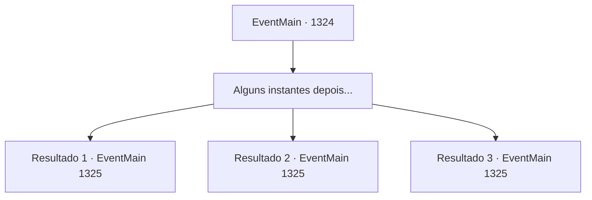

# Eventos principais · 1324

[Índice da tabela](index.md) · [Índice geral](../index.md)

ID: `pt:EventMain:1324` · Fonte: `EventMain4` · Versão: 1.2.47.

Mapeamento estático dos arquivos; a disponibilidade e a execução dependem do estado da run.

## Texto do evento

*Sem texto no arquivo.*

## Dados de entrada

```json
{
  "id": 1324,
  "grade": 1,
  "normalGoal": "",
  "required": ""
}
```

## Mapa das escolhas



## Escolhas e resultados

### Escolha 1

Alguns instantes depois...

Requisitos e outros campos da escolha:

```json
{
  "required": ""
}
```

#### Resultado 1.1

Enquanto você está ocupado se preparando para a guerra, Rennart entra apressado no seu gabinete e fala. 

 "Meu senhor. Um relatório de nossos batedores — exércitos de quatro Casas estão marchando para o Castelo Briovich enquanto falamos."

 A Aliança de nobres chega ao Castelo Briovich três dias após o relatório. Você sobe nas muralhas do castelo e observa as forças inimigas. As planícies estão adornadas com uma coleção de bandeiras das Casas, incluindo a da Casa Greymoor. Soldados da Aliança ocupam a área. Você levanta a mão para sinalizar seus arqueiros. Arqueiros nas muralhas do castelo preparam os tiros. O som das cordas dos arcos se esticando ecoa pelo ar. Logo, a Aliança começa a investida com um alto grito de guerra. A bandeira da Casa Greymoor lidera a carga. Você abaixa a mão, sinalizando para os arqueiros atirarem. Uma chuva de flechas cai sobre os soldados. As linhas de frente caem, mas a Aliança responde levantando seus escudos. A marcha continua. Você observa a cena se desenrolar, então se volta para os engenheiros. Os troncos pendurados nas muralhas do castelo começam a rolar. Pontas de lanças pontiagudas que atravessam os troncos brilham sob a luz do sol. Eles descem a encosta, lançados contra as forças da Aliança. 

 "ARGHH--!"

 O som de soldados sendo esmagados ecoa pelas planícies. Mas ainda assim, a Aliança não para. Logo, escadas são instaladas nas muralhas do castelo. 

 "Não deixem que subam!!"

 O som da madeira batendo nas paredes de pedra e de soldados com armadura de metal subindo as escadas. Você ataca os soldados da Aliança das muralhas do castelo.

Continuação registrada: [Evento 1325](1325.md) na mesma tabela.

```json
{
  "required": "5_965_1",
  "chance": "1",
  "nextEvent": 1325,
  "type": 2,
  "reward": "6_0_204",
  "place": 4
}
```

#### Resultado 1.2

Enquanto você está ocupado se preparando para a guerra, Rennart entra às pressas no seu gabinete e fala. 

 "Meu senhor. Um relatório dos nossos batedores — exércitos de quatro Casas estão marchando para o Castelo Briovich enquanto falamos."

 A Aliança de nobres chega ao Castelo Briovich três dias após o relatório. Você sobe às muralhas do castelo e verifica as forças inimigas. As planícies estão adornadas com uma coleção de estandartes das Casas, incluindo o da Casa Greymoor. Soldados da Aliança ocupam a área. Você levanta a mão para sinalizar seus arqueiros. Os arqueiros nas muralhas do castelo empunham suas flechas. O som das cordas dos arcos se tensionando ecoa pelo ar. Logo, a Aliança começa a carregar com um alto grito de guerra. O estandarte da Casa Greymoor lidera a investida. Você abaixa a mão, sinalizando para os arqueiros atirarem. Uma tempestade de flechas cai sobre os soldados. As linhas de frente caem, mas a Aliança responde erguendo seus escudos. A marcha continua. Você observa a cena se desenrolar, então sinaliza mais uma vez. Enquanto os arqueiros inclinam os caldeirões, areia aquecida é despejada sobre os soldados. 

 "ARGHH--! QUEIMA!"

 O imenso calor pega os soldados desprevenidos enquanto eles caem. Mas ainda assim, a Aliança não para. Logo, escadas são colocadas nas muralhas do castelo. 

 "Não deixe que subam!!"

 O som da madeira batendo nas paredes de pedra e soldados com armadura de metal subindo as escadas. Você ataca os soldados da Aliança a partir das muralhas do castelo.

Continuação registrada: [Evento 1325](1325.md) na mesma tabela.

```json
{
  "required": "5_966_1",
  "chance": "1",
  "nextEvent": 1325,
  "type": 2,
  "reward": "6_0_204",
  "place": 4
}
```

#### Resultado 1.3

Enquanto você está ocupado se preparando para a guerra, Rennart entra apressado no seu escritório e fala. 

 "Meu Senhor. Um relatório dos nossos batedores — exércitos de quatro Casas estão marchando rumo ao Castelo Briovich enquanto falamos."

 A aliança de nobres chega ao Castelo Briovich três dias após o relatório. Você sobe às muralhas do castelo e observa as forças inimigas. As planícies estão adornadas com uma coleção de estandartes das Casas, incluindo o da Casa Greymoor. Soldados da Aliança ocupam a área. Eles formaram um posto avançado em frente ao castelo e até trouxeram um aríete e uma torre de cerco. Você levanta a mão para sinalizar seus arqueiros. Arqueiros nas muralhas do castelo preparam os arcos. Logo, a Aliança começa a chargear com um brado de guerra alto. O estandarte da Casa Greymoor lidera a investida. Você abaixa a mão, sinalizando os arqueiros para disparar. Uma tempestade de flechas cai sobre os soldados. Mas a Aliança responde erguendo seus escudos. A marcha continua. As máquinas de cerco se aproximam das muralhas do castelo. Você percebe isso, então envia um sinal para a balista. 

 'BOOM!!' 

 o virote pesado disparado pela balista corta o ar. O primeiro tiro desacelera a torre de cerco. A estrutura de madeira treme. O segundo tiro destrói suas rodas, e a torre de cerco cai ao chão. 

 "Atacar! AVANTE!"

 Mas ainda assim a Aliança não para. Logo, escadas são erguidas nas muralhas do castelo. 

 "Não deixem que subam!!"

 O som da madeira batendo contra as paredes de pedra e de soldados de armadura metálica subindo as escadas. Você ataca os soldados da Aliança a partir das muralhas do castelo.

Continuação registrada: [Evento 1325](1325.md) na mesma tabela.

```json
{
  "required": "5_964_3",
  "chance": "1",
  "nextEvent": 1325,
  "type": 2,
  "reward": "6_2_204",
  "place": 4
}
```

## Referências que chegam a este evento

- [Evento 1322 · escolha 2 · resultado 1](1322.md#escolha-2)
- [Evento 1322 · escolha 3 · resultado 1](1322.md#escolha-3)
- [Evento 1322 · escolha 4 · resultado 1](1322.md#escolha-4)
- [Evento 1323 · escolha 1 · resultado 1](1323.md#escolha-1)
- [Evento 1323 · escolha 2 · resultado 1](1323.md#escolha-2)
