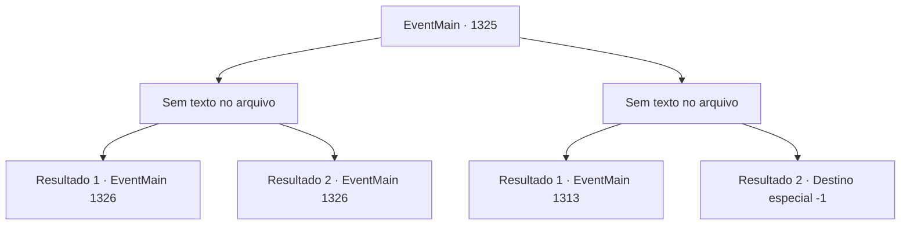

# Eventos principais · 1325

[Índice da tabela](index.md) · [Índice geral](../index.md)

ID: `pt:EventMain:1325` · Fonte: `EventMain4` · Versão: 1.2.47.

Mapeamento estático dos arquivos; a disponibilidade e a execução dependem do estado da run.

## Texto do evento

*Sem texto no arquivo.*

## Dados de entrada

```json
{
  "id": 1325,
  "grade": 1,
  "normalGoal": "",
  "required": ""
}
```

## Mapa das escolhas



## Escolhas e resultados

### Escolha 1

*Sem texto no arquivo; o papel dessa opção depende da interface do jogo.*

Requisitos e outros campos da escolha:

```json
{
  "required": ""
}
```

#### Resultado 1.1

Você se junta aos seus soldados para repelir a Aliança. Eles recuam momentaneamente para seu posto avançado para se recuperar. Você retorna ao escritório para receber um relatório sobre os danos causados. 

 "Tivemos algumas baixas... mas nada grave."

 Rennart folheia o documento e continua. 

 "Mas... se arrastarmos este cerco por muito tempo, eventualmente ficaremos sem suprimentos."


Continuação registrada: [Evento 1326](1326.md) na mesma tabela.

```json
{
  "required": "18_964_3",
  "chance": "1",
  "nextEvent": 1326,
  "type": 2,
  "reward": ""
}
```

#### Resultado 1.2

Você se junta aos seus soldados para repelir a Aliança. Eles recuam momentaneamente para seu posto avançado para se recuperar. Você retorna ao escritório para receber um relatório sobre os danos causados. 

 "Tivemos algumas baixas... mas nada grave."

 Rennart folheia o documento e continua. 

 "Mas... se arrastarmos este cerco por muito tempo, eventualmente ficaremos sem suprimentos."


Continuação registrada: [Evento 1326](1326.md) na mesma tabela.

```json
{
  "required": "5_964_3",
  "chance": "1",
  "nextEvent": 1326,
  "type": 2,
  "reward": ""
}
```

### Escolha 2

*Sem texto no arquivo; o papel dessa opção depende da interface do jogo.*

Requisitos e outros campos da escolha:

```json
{
  "required": ""
}
```

#### Resultado 2.1

O aríete da Aliança arromba os portões do castelo. Então, Rennart se aproxima de você, brandindo a espada, e grita. 

 "Meu senhor, você deve recuar para a torre de menagem!"

 Você e Rennart recuam para a torre de menagem e se preparam para resistir ali. Você tranca todas as portas e janelas que encontra, depois monta uma barricada improvisada com móveis. Você posiciona seus soldados em todas as entradas. 

 "E- eles estão vindo!"

 Os soldados exclamam, e logo ouve-se uma forte pancada. Eles estão tentando arrombar a porta do lado de fora da torre de menagem.

Continuação registrada: [Evento 1313](1313.md) na mesma tabela.

```json
{
  "required": "1_0_2|1_1_2",
  "chance": "1",
  "nextEvent": 1313,
  "type": 2,
  "reward": "0_0_-1|0_1_-1"
}
```

#### Resultado 2.2

Você tenta comandar seus soldados das muralhas do castelo. Mas então, uma flecha da Aliança crava-se profundamente no seu ombro esquerdo. Você perde o equilíbrio e cai das muralhas do castelo. Com um estrondo, você bate no chão, enquanto sua visão fica vermelha. Seus membros não obedecem. Você encara o céu com olhar vazio antes de fechar os olhos. O grito terrível, o fedor de sangue e a dor que dilacera a mente — tudo logo deixa de existir.

Continuação registrada: [Destino especial `-1`](../destinos-especiais.md).

```json
{
  "required": "-1|2_0_2|2_1_2",
  "chance": "1",
  "nextEvent": -1,
  "type": 2,
  "reward": "15_7_11|0_0_-1|0_1_-1|25_8_1"
}
```

## Referências que chegam a este evento

- [Evento 1324 · escolha 1 · resultado 1](1324.md#escolha-1)
- [Evento 1324 · escolha 1 · resultado 2](1324.md#escolha-1)
- [Evento 1324 · escolha 1 · resultado 3](1324.md#escolha-1)
