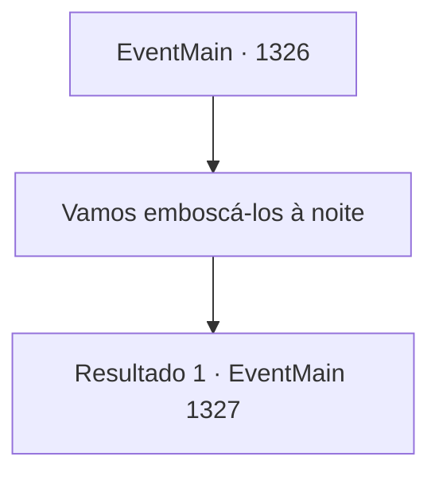

# Eventos principais · 1326

[Índice da tabela](index.md) · [Índice geral](../index.md)

ID: `pt:EventMain:1326` · Fonte: `EventMain4` · Versão: 1.2.47.

Mapeamento estático dos arquivos; a disponibilidade e a execução dependem do estado da run.

## Texto do evento

*Sem texto no arquivo.*

## Dados de entrada

```json
{
  "id": 1326,
  "grade": 1,
  "normalGoal": "",
  "required": ""
}
```

## Mapa das escolhas



## Escolhas e resultados

### Escolha 1

Vamos emboscá-los à noite

Requisitos e outros campos da escolha:

```json
{
  "required": ""
}
```

#### Resultado 1.1

Você sugere um ataque noturno ao posto avançado. Rennart considera por alguns segundos e assente. 

 "Entendido. Vou reunir alguns homens."

 Você confere seu equipamento novamente e segue para a praça do castelo. Lá, soldados esperam por suas ordens. Mas eles não parecem estar de bom ânimo. As lutas contínuas os exauriram, sem falar no fardo mental de atacar um exército muito maior do que o deles.

Continuação registrada: [Evento 1327](1327.md) na mesma tabela.

```json
{
  "required": "",
  "chance": "1",
  "nextEvent": 1327,
  "type": 2,
  "reward": ""
}
```

## Referências que chegam a este evento

- [Evento 1325 · escolha 1 · resultado 1](1325.md#escolha-1)
- [Evento 1325 · escolha 1 · resultado 2](1325.md#escolha-1)
