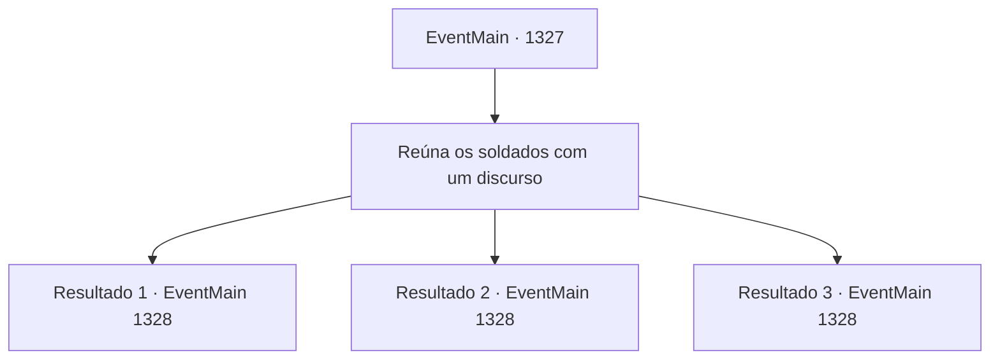

# Eventos principais · 1327

[Índice da tabela](index.md) · [Índice geral](../index.md)

ID: `pt:EventMain:1327` · Fonte: `EventMain4` · Versão: 1.2.47.

Mapeamento estático dos arquivos; a disponibilidade e a execução dependem do estado da run.

## Texto do evento

*Sem texto no arquivo.*

## Dados de entrada

```json
{
  "id": 1327,
  "grade": 1,
  "normalGoal": "",
  "required": ""
}
```

## Mapa das escolhas



## Escolhas e resultados

### Escolha 1

Reúna os soldados com um discurso

Requisitos e outros campos da escolha:

```json
{
  "required": ""
}
```

#### Resultado 1.1

Você imediatamente chama a atenção dos soldados e inicia um discurso majestoso sobre por que eles devem lutar. Você lhes diz que ficar parado não os levará à vitória, e que agora é hora de lutarem pelas vidas daqueles que amam. Os soldados são inflamados pelo seu discurso. Eles apertam o cabo de suas armas com o ânimo renovado. 

 "— Abrirei os portões agora, meu Senhor."

 Logo, o portão do castelo se abre. Você adentra a escuridão com o resto de seus homens. Apenas a fraca luz de tochas tremula no posto avançado. Você se agacha e sinaliza para seus homens se aproximarem. Então, quando está bem em frente ao posto avançado, solta um brado de guerra e avança em carga. <link=shake>

 "WAAAAAAAAAA!!"

</link> 

 "E- EMBOSCADA INIMIGA!"

 Soldados da Aliança finalmente o encontraram. Eles reagem rapidamente, mas a maré da batalha já virou.

Continuação registrada: [Evento 1328](1328.md) na mesma tabela.

```json
{
  "required": "5_881_1",
  "chance": "1|0_12_1",
  "nextEvent": 1328,
  "type": 0,
  "reward": "6_2_204",
  "place": 13
}
```

#### Resultado 1.2

Você imediatamente chama a atenção dos soldados e inicia um discurso majestoso sobre por que eles devem lutar. Mas apesar do seu discurso apaixonado, os soldados ainda estão desanimados. 

 "Abrirei os portões agora, meu Senhor."

 Logo, o portão do castelo se abre. Você adentra a escuridão com o resto de seus homens. Apenas uma fraca luz de tochas tremula no posto avançado. Você se agacha e sinaliza para seus homens se aproximarem. Então, quando você está bem em frente ao posto avançado, solta um grito de guerra e investe. 

 <link=shake>'DINGDINGDINGDINGDINGDING!!'</link> 

 "Inimigo a caminho! Não entrem em pânico, defendam-se!"

 Os guardas tocam calmamente os sinos de alarme e preparam um contra-ataque.

Continuação registrada: [Evento 1328](1328.md) na mesma tabela.

```json
{
  "required": "5_881_1",
  "chance": "18",
  "nextEvent": 1328,
  "type": 1,
  "reward": "6_0_204",
  "place": 13
}
```

#### Resultado 1.3

Você imediatamente chama a atenção dos soldados e começa um discurso majestoso sobre por que eles devem lutar. Você lhes diz que ficar parado não levará à vitória, e que agora é a hora de lutarem pelas vidas daqueles que amam. Tarrys ouve seu discurso e ergue sua lança para o céu com expressão emocionada. Outros soldados seguem o exemplo, apertando firme suas armas. 

 "Vou abrir os portões agora, meu senhor."

 Logo, o portão do castelo se abre. Você avança na escuridão com o resto de seus homens. Apenas a fraca luz das tochas tremula no posto avançado. Você se agacha e sinaliza para seus homens se aproximarem. Então, quando você está bem em frente ao posto avançado, solta um grito de batalha e investe. 

 "WAAAAAAAAAA!!"

 "E- EMBOCADA INIMIGA!"

 Soldados da Aliança finalmente o encontraram. Eles reagem apressadamente, mas a maré da batalha já virou.

Continuação registrada: [Evento 1328](1328.md) na mesma tabela.

```json
{
  "required": "18_881_1",
  "chance": "1",
  "nextEvent": 1328,
  "type": 2,
  "reward": "6_2_204",
  "place": 13
}
```

## Referências que chegam a este evento

- [Evento 1326 · escolha 1 · resultado 1](1326.md#escolha-1)
