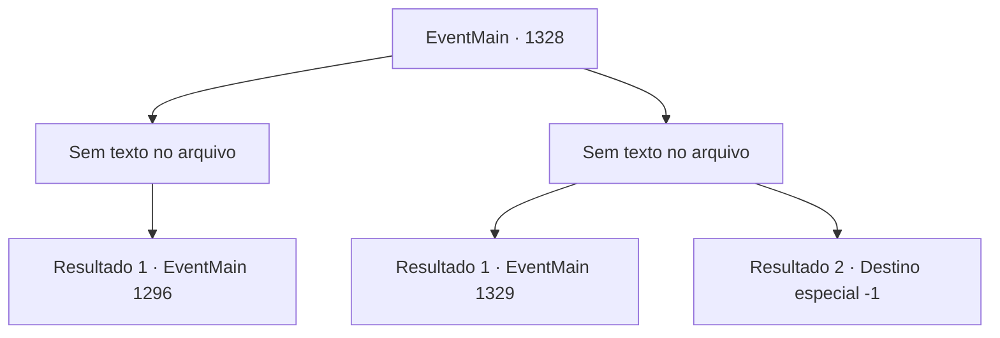

# Eventos principais · 1328

[Índice da tabela](index.md) · [Índice geral](../index.md)

ID: `pt:EventMain:1328` · Fonte: `EventMain4` · Versão: 1.2.47.

Mapeamento estático dos arquivos; a disponibilidade e a execução dependem do estado da run.

## Texto do evento

*Sem texto no arquivo.*

## Dados de entrada

```json
{
  "id": 1328,
  "grade": 1,
  "normalGoal": "",
  "required": ""
}
```

## Mapa das escolhas



## Escolhas e resultados

### Escolha 1

*Sem texto no arquivo; o papel dessa opção depende da interface do jogo.*

Requisitos e outros campos da escolha:

```json
{
  "required": ""
}
```

#### Resultado 1.1

Você lidera seus homens e causa estragos no posto avançado. Você derruba os cavaleiros e soldados que resistem, amarrando como prisioneiros os que se rendem. Em seguida, você ateia fogo aos equipamentos de cerco, alinhados no canto. A torre de cerco e o aríete são engolidos pelas chamas. Você finalmente chega ao armazém, ateia fogo lá também e retorna ao seu castelo com seus soldados. Fogo e fumaça fornecem uma cobertura natural para você e seus homens. Você retorna em segurança ao castelo, tranca os prisioneiros na prisão e elogia seus soldados. 

 Um novo dia começa, mas nenhum ataque vem da Aliança. Rennart se aproxima de você e pergunta. 

 "O que você fará com os prisioneiros?"


Continuação registrada: [Evento 1296](1296.md) na mesma tabela.

```json
{
  "required": "",
  "chance": "1",
  "nextEvent": 1296,
  "type": 2,
  "reward": ""
}
```

### Escolha 2

*Sem texto no arquivo; o papel dessa opção depende da interface do jogo.*

Requisitos e outros campos da escolha:

```json
{
  "required": ""
}
```

#### Resultado 2.1

Você lidera seus homens e provoca estragos no posto avançado. Mas a Aliança oferece bastante resistência. Cavaleiros e soldados ficam costas com costas, resistindo. Mesmo os soldados que perderam suas armas vêm até você segurando pedras e galhos de árvores. A batalha se arrasta, e seus soldados começam a sofrer danos consideráveis também. Ai de você, é forçado a recuar, incapaz de romper a resistência da Aliança. 

 Dois dias depois, um mensageiro vem da Aliança. Você conhece seu nome. Sir Wojciech. Um cavaleiro leal de Katrin, que serviu à Casa Greymoor desde o governo de seu pai. 

 "Não acha que já é hora de se render?"

 Ele para brevemente e olha para você. 

 "Os custos de uma guerra prolongada são sofridos por soldados e civis. É época de semeadura, em breve. Se você continuar esta batalha, a Propriedade Briovich acabará por encontrar sua ruína."

 Wojciech continua calmamente. 

 "Se você escolher se render agora, eu pessoalmente farei com que seus direitos básicos e fundamentais sejam preservados."

 Você olha pela janela. Longe, você consegue ouvir os gemidos de soldados feridos e civis famintos.

Continuação registrada: [Evento 1329](1329.md) na mesma tabela.

```json
{
  "required": "1_0_2|1_1_2",
  "chance": "1",
  "nextEvent": 1329,
  "type": 2,
  "reward": "0_0_-1|0_1_-1"
}
```

#### Resultado 2.2

Um cavaleiro da Aliança mira seu pescoço com a espada. Você dá um passo para trás e desvia, mas naquele instante uma lança atravessa seu abdômen. Atingido pela lança, você é lançado ao chão. Ao seu redor, você ouve gritos e o brado dos soldados. Sua visão começa a embaçar enquanto sua consciência se desvanece.

Continuação registrada: [Destino especial `-1`](../destinos-especiais.md).

```json
{
  "required": "-1|2_0_2|2_1_2",
  "chance": "1",
  "nextEvent": -1,
  "type": 2,
  "reward": "0_0_-1|0_1_-1|15_7_11|25_8_1"
}
```

## Referências que chegam a este evento

- [Evento 1327 · escolha 1 · resultado 1](1327.md#escolha-1)
- [Evento 1327 · escolha 1 · resultado 2](1327.md#escolha-1)
- [Evento 1327 · escolha 1 · resultado 3](1327.md#escolha-1)
