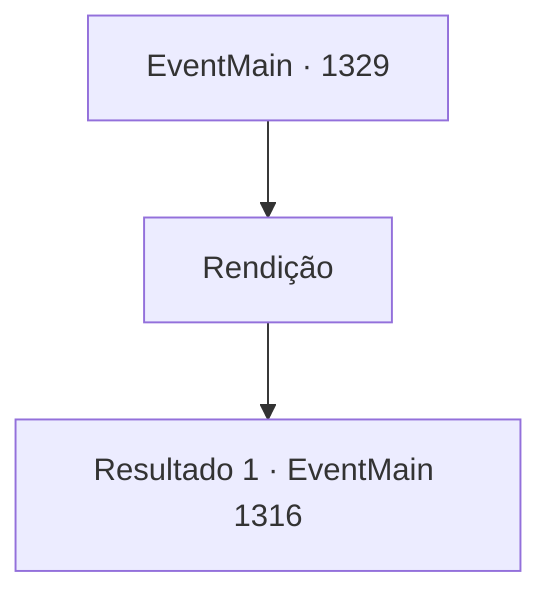

# Eventos principais · 1329

[Índice da tabela](index.md) · [Índice geral](../index.md)

ID: `pt:EventMain:1329` · Fonte: `EventMain4` · Versão: 1.2.47.

Mapeamento estático dos arquivos; a disponibilidade e a execução dependem do estado da run.

## Texto do evento

*Sem texto no arquivo.*

## Dados de entrada

```json
{
  "id": 1329,
  "grade": 1,
  "normalGoal": "",
  "required": ""
}
```

## Mapa das escolhas



## Escolhas e resultados

### Escolha 1

Rendição

Requisitos e outros campos da escolha:

```json
{
  "required": ""
}
```

#### Resultado 1.1

Infelizmente, você decide se render. 

 "...Meu Senhor."

 Rennart olha para você, entristecido. Você diz a ele para não se preocupar e segue Wojciech para fora. Você pega uma carruagem para o Castelo Greymoor. 

 Katrin e alguns outros nobres já estão esperando por você no escritório. 

 "Condessa Greymoor, como você planeja lidar com Briovich?"

 Katrin responde lentamente. 

 "O crime de abrigar um necromante é grave. A lei determina que eu envie este caso ao tribunal real."

 Ela observa os nobres ao redor e continua. 

 "Mas não podemos deixar isso acontecer, podemos? Nós derramamos todo esse sangue e não recebemos nada em troca por tudo isso?"

 Ela coloca um documento sobre a mesa. Nele está escrito um contrato, cujos termos retiram a maior parte dos seus direitos sobre a propriedade, deixando apenas seu título de nobreza. 

 "Agora, você assinaria gentilmente este contrato para mim?"


Continuação registrada: [Evento 1316](1316.md) na mesma tabela.

```json
{
  "required": "",
  "chance": "1",
  "nextEvent": 1316,
  "type": 2,
  "reward": ""
}
```

## Referências que chegam a este evento

- [Evento 1328 · escolha 2 · resultado 1](1328.md#escolha-2)
