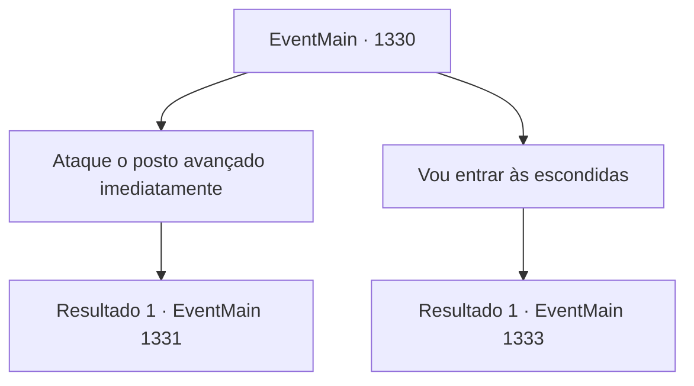

# Eventos principais · 1330

[Índice da tabela](index.md) · [Índice geral](../index.md)

ID: `pt:EventMain:1330` · Fonte: `EventMain4` · Versão: 1.2.47.

Mapeamento estático dos arquivos; a disponibilidade e a execução dependem do estado da run.

## Texto do evento

*Sem texto no arquivo.*

## Dados de entrada

```json
{
  "id": 1330,
  "grade": 1,
  "normalGoal": "",
  "required": ""
}
```

## Mapa das escolhas



## Escolhas e resultados

### Escolha 1

Ataque o posto avançado imediatamente

Requisitos e outros campos da escolha:

```json
{
  "required": ""
}
```

#### Resultado 1.1

Você sugere que ataque o posto avançado antes que seja fortificado. 

 "Muito bem, então farei os preparativos imediatamente."

 Rennart obedece ao seu comando e começa a reunir os soldados. 

 Poucos minutos depois, você sai do escritório e se dirige à praça do castelo. Os soldados já estão esperando por suas ordens lá. Você os conduz para fora dos portões frontais, em seguida em direção ao posto avançado. 

 O posto avançado da Aliança está bem encaminhado para ser fortificado. Cercas de madeira erguem-se ao redor do perímetro, e uma vala rasa está sendo cavada no momento.

Continuação registrada: [Evento 1331](1331.md) na mesma tabela.

```json
{
  "required": "",
  "chance": "1",
  "nextEvent": 1331,
  "type": 2,
  "reward": ""
}
```

### Escolha 2

Vou entrar às escondidas

Requisitos e outros campos da escolha:

```json
{
  "required": ""
}
```

#### Resultado 2.1

Você diz a ele que vai infiltrar-se no posto avançado você mesmo e assassinar o comandante da Aliança. Rennart acena em resposta. 

 "Por aqui - as cercas estão incompletas no setor leste. Será muito mais fácil infiltrar-se por aí."

 Os dedos dele apontam para o oeste do posto avançado. 

 "Enquanto você se esgueira para dentro, eu os distraio na frente."

 Ele olha para você com preocupação. 

 "Por favor, tenha cuidado, meu Senhor."


Continuação registrada: [Evento 1333](1333.md) na mesma tabela.

```json
{
  "required": "",
  "chance": "1",
  "nextEvent": 1333,
  "type": 2,
  "reward": ""
}
```

## Referências que chegam a este evento

- [Evento 1312 · escolha 1 · resultado 1](1312.md#escolha-1)
