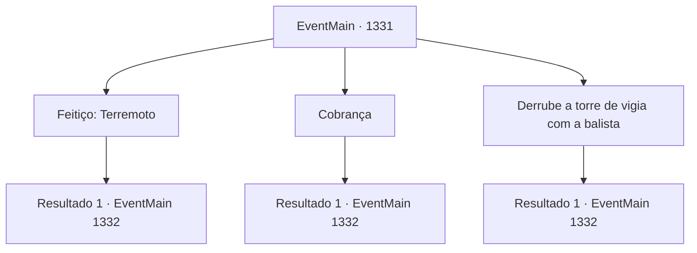

# Eventos principais · 1331

[Índice da tabela](index.md) · [Índice geral](../index.md)

ID: `pt:EventMain:1331` · Fonte: `EventMain4` · Versão: 1.2.47.

Mapeamento estático dos arquivos; a disponibilidade e a execução dependem do estado da run.

## Texto do evento

*Sem texto no arquivo.*

## Dados de entrada

```json
{
  "id": 1331,
  "grade": 1,
  "normalGoal": "",
  "required": ""
}
```

## Mapa das escolhas



## Escolhas e resultados

### Escolha 1

Feitiço: Terremoto

Requisitos e outros campos da escolha:

```json
{
  "required": "5_969_0|20_0_4|1_1_2"
}
```

#### Resultado 1.1

Você se coloca à frente de seus soldados e conjura um feitiço. O chão estremece por sua magia, e começa a tremer.

 <b><link=shake>'RUMBBBLLEEE--!'</link></b>

 Uma fissura aparece no chão com um estrondo alto. As cercas de madeira e as torres de vigia improvisadas todas desabam. 

 "UOOOAAH!!"

 Seus soldados olham para você com respeito e admiração. Você sinaliza aos seus homens para começarem a atacar o posto avançado. Eles erguem suas armas para o céu e gritam. 

 "PELO Briovich!!"

 Você lidera seus homens, atacando a Aliança. Os soldados da Aliança entram em pânico, defendendo-se apressadamente dos ataques.

Continuação registrada: [Evento 1332](1332.md) na mesma tabela.

```json
{
  "required": "",
  "chance": "1",
  "nextEvent": 1332,
  "type": 2,
  "reward": "6_2_204|0_1_-1|5_969_1",
  "place": 13
}
```

### Escolha 2

Cobrança

Requisitos e outros campos da escolha:

```json
{
  "required": ""
}
```

#### Resultado 2.1

Você assume a linha de frente da investida, atacando o posto avançado de frente. A Aliança revida com lanças por trás das cercas de madeira. Flechas começam a chover das torres de vigia. 

 "Levantem seus escudos!!"

 O combate corpo a corpo entre os Briovich e a Aliança começa. Você também entra na luta.

Continuação registrada: [Evento 1332](1332.md) na mesma tabela.

```json
{
  "required": "",
  "chance": "1",
  "nextEvent": 1332,
  "type": 2,
  "reward": "6_0_204",
  "place": 13
}
```

### Escolha 3

Derrube a torre de vigia com a balista

Requisitos e outros campos da escolha:

```json
{
  "required": "5_964_3"
}
```

#### Resultado 3.1

Você ordena a um dos seus soldados que traga a balista. Ele é acompanhado por mais alguns soldados, que correm até o castelo e voltam com a balista em uma carroça. Cuidadosamente, eles abaixam a balista no chão. Começam a operá-la. Ao puxarem a alavanca, a mola grossa começa a tensionar. O dardo afiado da balista armazena a força e é então lançado à frente. Uma torre de vigia é derrubada com um único disparo. 

 "Recarregar!"

 Restam mais três torres de vigia - os soldados carregam apressadamente outro dardo na balista. Então, soldados da Aliança começam a sair em massa do posto avançado, atacando você e seus homens. 

 "MORRA, Briovich!!"

 Começa o combate corpo a corpo entre os Briovich e a Aliança. Você também entra na luta.

Continuação registrada: [Evento 1332](1332.md) na mesma tabela.

```json
{
  "required": "",
  "chance": "1",
  "nextEvent": 1332,
  "type": 2,
  "reward": "6_2_204",
  "place": 13
}
```

## Referências que chegam a este evento

- [Evento 1330 · escolha 1 · resultado 1](1330.md#escolha-1)
