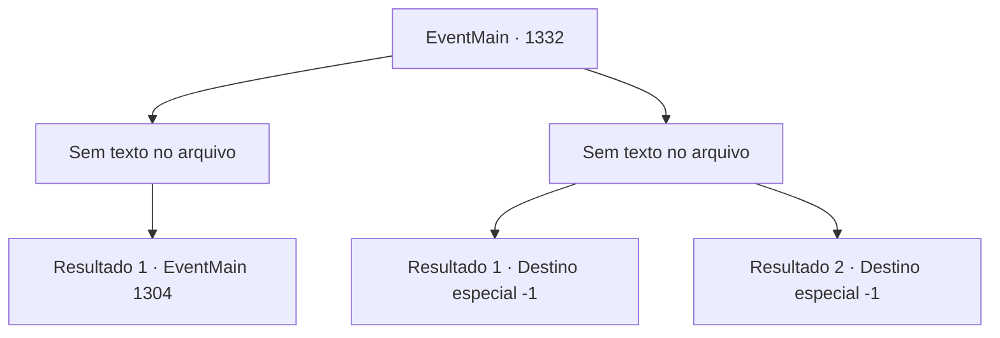

# Eventos principais · 1332

[Índice da tabela](index.md) · [Índice geral](../index.md)

ID: `pt:EventMain:1332` · Fonte: `EventMain4` · Versão: 1.2.47.

Mapeamento estático dos arquivos; a disponibilidade e a execução dependem do estado da run.

## Texto do evento

*Sem texto no arquivo.*

## Dados de entrada

```json
{
  "id": 1332,
  "grade": 1,
  "normalGoal": "",
  "required": ""
}
```

## Mapa das escolhas



## Escolhas e resultados

### Escolha 1

*Sem texto no arquivo; o papel dessa opção depende da interface do jogo.*

Requisitos e outros campos da escolha:

```json
{
  "required": ""
}
```

#### Resultado 1.1

Você lida com os inimigos e olha ao redor. O posto avançado está completamente destruído. Cadáveres de soldados da Aliança estão espalhados pela área. Chamas começam a subir aqui e ali. Após vasculhar o posto avançado, Rennart se aproxima de você. 

 "Meu Senhor."

 Ele inclina-se brevemente antes de lhe dar um relatório. 

 "Prendemos os prisioneiros na cadeia. Nossos soldados estão encontrando e reivindicando suprimentos e armamento. Os sobreviventes da Aliança estão sendo procurados enquanto falamos."

 Você dá uma breve pausa aos seus soldados, então segue direto para o Castelo Greymoor. Você sabe que enquanto o líder da Aliança, a Casa Greymoor, permanecer intacto, a guerra nunca terminará. Alguns dias depois, você chega ao Castelo Greymoor, apenas para encontrar seus portões frontais fechados e silenciosos. Os portões estão fortemente trancados, e os soldados no topo das muralhas do castelo olham para você nervosamente.

Continuação registrada: [Evento 1304](1304.md) na mesma tabela.

```json
{
  "required": "",
  "chance": "1",
  "nextEvent": 1304,
  "type": 2,
  "reward": ""
}
```

### Escolha 2

*Sem texto no arquivo; o papel dessa opção depende da interface do jogo.*

Requisitos e outros campos da escolha:

```json
{
  "required": ""
}
```

#### Resultado 2.1

Um cavaleiro da Aliança mira o seu pescoço com a espada. Você dá um passo para trás e desvia, mas então uma lança atravessa seu abdômen. Perfuro pelo impacto da lança, você é lançado ao chão. Ao seu redor, ouve-se gritos e berros de soldados. Sua visão começa a turvar, enquanto sua consciência se esvai.

Continuação registrada: [Destino especial `-1`](../destinos-especiais.md).

```json
{
  "required": "5_959_1",
  "chance": "1",
  "nextEvent": -1,
  "type": 2,
  "reward": "0_0_-1|0_1_-1|15_7_26|25_8_1"
}
```

#### Resultado 2.2

Um cavaleiro da Aliança mira o seu pescoço com a espada. Você dá um passo para trás e desvia, mas então uma lança atravessa seu abdômen. Perfuro pelo impacto da lança, você é lançado ao chão. Ao seu redor, ouve-se gritos e berros de soldados. Sua visão começa a turvar, enquanto sua consciência se esvai.

Continuação registrada: [Destino especial `-1`](../destinos-especiais.md).

```json
{
  "required": "18_959_1",
  "chance": "1",
  "nextEvent": -1,
  "type": 2,
  "reward": "0_0_-1|0_1_-1|15_7_11|25_8_1"
}
```

## Referências que chegam a este evento

- [Evento 1331 · escolha 1 · resultado 1](1331.md#escolha-1)
- [Evento 1331 · escolha 2 · resultado 1](1331.md#escolha-2)
- [Evento 1331 · escolha 3 · resultado 1](1331.md#escolha-3)
