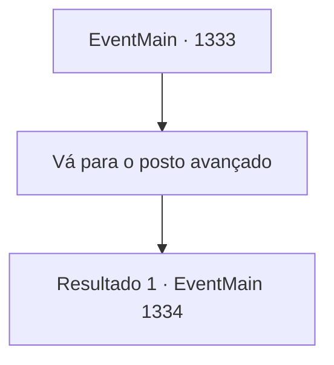

# Eventos principais · 1333

[Índice da tabela](index.md) · [Índice geral](../index.md)

ID: `pt:EventMain:1333` · Fonte: `EventMain4` · Versão: 1.2.47.

Mapeamento estático dos arquivos; a disponibilidade e a execução dependem do estado da run.

## Texto do evento

*Sem texto no arquivo.*

## Dados de entrada

```json
{
  "id": 1333,
  "grade": 1,
  "normalGoal": "",
  "required": ""
}
```

## Mapa das escolhas



## Escolhas e resultados

### Escolha 1

Vá para o posto avançado

Requisitos e outros campos da escolha:

```json
{
  "required": ""
}
```

#### Resultado 1.1

Você percebe que o sol está quase se pondo, indo para o céu do sul. Rennart lidera os soldados até a frente do posto avançado. Os soldados tocam suas cornetas de guerra e flautas, causando distração. Flechas e maldições voam pelo ar. Você contorna uma colina e segue para a parte de trás do posto avançado. Há um guarda na torre de vigia próxima. Você se esconde em um arbusto próximo e observa os soldados erguerem cercas de madeira. Eles cavam o chão e movem os pesados objetos de madeira, suados e cansados.

Continuação registrada: [Evento 1334](1334.md) na mesma tabela.

```json
{
  "required": "",
  "chance": "1",
  "nextEvent": 1334,
  "type": 2,
  "reward": ""
}
```

## Referências que chegam a este evento

- [Evento 1330 · escolha 2 · resultado 1](1330.md#escolha-2)
