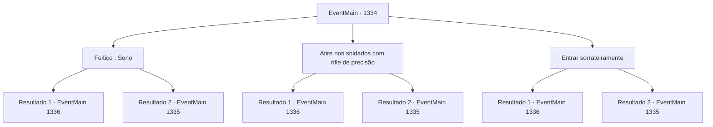

# Eventos principais · 1334

[Índice da tabela](index.md) · [Índice geral](../index.md)

ID: `pt:EventMain:1334` · Fonte: `EventMain4` · Versão: 1.2.47.

Mapeamento estático dos arquivos; a disponibilidade e a execução dependem do estado da run.

## Texto do evento

*Sem texto no arquivo.*

## Dados de entrada

```json
{
  "id": 1334,
  "grade": 1,
  "normalGoal": "",
  "required": ""
}
```

## Mapa das escolhas



## Escolhas e resultados

### Escolha 1

Feitiço : Sono

Requisitos e outros campos da escolha:

```json
{
  "required": "20_0_2|1_1_2"
}
```

#### Resultado 1.1

Você lança Sono no sentinela na torre de vigia. Sua cabeça se inclina para fora da borda, lentamente. Você infiltra-se no posto avançado e lança o mesmo feitiço sobre os soldados trabalhadores. Eles não oferecem resistência alguma enquanto caem num sono tranquilo. Você se move de tenda em tenda, escondendo-se nas sombras enquanto avança. 

 "Os inimigos estão formando posições na frente!"

 "Todos, ocupem as posições e mantenham o terreno!"

 A atenção dos soldados da Aliança está totalmente voltada para a frente. Você observa seus movimentos por um instante antes de se afastar. Você nota uma tenda enorme, muito maior que as outras, colocada no ponto mais alto. Nela está uma bandeira com o brasão da Casa Greymoor — o grifo — estampado. Ao lado, mais bandeiras, cada uma com um símbolo: uma serpente prateada, um urso amarelo e um arco vermelho. Casas da Aliança. Esse deve ser o quartel-general da Aliança. Então, você vê alguns cavaleiros saindo da tenda. Cada um tem um brasão único na couraça. Eles se apressam rumo ao cenário da batalha, conversando. 

 "Veja como estão desesperados — devem estar ficando sem comida. Teremos uma vitória fácil se prolongarmos o cerco."

 Então, outro cavaleiro rebate. 

 "Isso não é verdade. Ouvi dizer que o Castelo Briovich tem pelo menos quatro meses de suprimentos. Sem contar que logo é época de plantio. Não devemos perder tempo."

 Você percebe um rosto familiar ali. Você sabe seu nome. Sir Wojciech. Um cavaleiro leal de Katrin, que serviu à Casa Greymoor desde o governo do seu pai. Wojciech parece perdido em pensamentos, ouvindo os outros cavaleiros em silêncio.

Continuação registrada: [Evento 1336](1336.md) na mesma tabela.

```json
{
  "required": "",
  "chance": "1|0_7_1|0_12_1",
  "nextEvent": 1336,
  "type": 0,
  "reward": "0_1_-1"
}
```

#### Resultado 1.2

Você se aproxima cuidadosamente do posto avançado para lançar Sono. Mas então, um dos soldados em serviço te percebe. 

 "E- LÁ! INIMIGO SE APROXIMA!"

 "ACABEM COM ELES!"

 Os soldados arremessam suas barreiras e avançam em sua direção. Você muda rapidamente seu feitiço, lançando magia contra eles.

Continuação registrada: [Evento 1335](1335.md) na mesma tabela.

```json
{
  "required": "",
  "chance": "32",
  "nextEvent": 1335,
  "type": 1,
  "reward": "6_2_204",
  "place": 13
}
```

### Escolha 2

Atire nos soldados com rifle de precisão

Requisitos e outros campos da escolha:

```json
{
  "required": "20_6_2"
}
```

#### Resultado 2.1

Você abate o sentinela da torre de vigia com precisão, eliminando-o silenciosamente. Você se infiltra no posto avançado e faz o mesmo com os soldados que trabalham. Eles não oferecem resistência alguma ao serem eliminados um por um. Você se move de barraca em barraca, escondendo-se nas sombras enquanto avança. 

 "Os inimigos estão formando fileiras na frente!"

 "Todos, ocupem posições e mantenham o terreno!"

 A atenção dos soldados da Aliança está toda voltada para a frente. Você observa os movimentos deles por um instante antes de se afastar. Você nota uma barraca enorme, muito maior que as outras, colocada no ponto mais alto. Nela está uma bandeira com o brasão da Casa Greymoor — o grifo — estampado. Ao lado, mais bandeiras, cada uma com o símbolo de uma serpente prateada, um urso amarelo e um arco vermelho. Casas da Aliança. Deve ser o quartel-general da Aliança. Então, você vê alguns cavaleiros saindo da barraca. Cada um tem um brasão diferente na cota de malha. Eles se apressam em direção ao campo de batalha, conversando. 

 "Olhem como estão desesperados — devem estar ficando sem comida. Teremos uma vitória fácil se prolongarmos o cerco."

 Então, outro cavaleiro retruca. 

 "Isso não é verdade. Ouvi dizer que o Castelo Briovich tem pelo menos quatro meses de suprimentos. Sem contar que a época de semeadura está próxima. Não devemos perder tempo."

 Você reconhece um rosto ali. Você sabe o nome dele. Sir Wojciech. Um cavaleiro leal a Katrin, que serve à Casa Greymoor desde o governo do seu pai. Wojciech parece perdido em pensamentos, ouvindo os outros cavaleiros em silêncio.

Continuação registrada: [Evento 1336](1336.md) na mesma tabela.

```json
{
  "required": "",
  "chance": "1|0_6_1",
  "nextEvent": 1336,
  "type": 0,
  "reward": ""
}
```

#### Resultado 2.2

Você se aproxima cuidadosamente do posto avançado para abater os soldados à distância. Mas então, um dos soldados em serviço te percebe. 

 "T- LÁ! INIMIGO SE APROXIMA!"

 "PEGA-O!"

 Os soldados jogam suas cercas fora e avançam contra você. Você muda rapidamente a mira, mirando naquele à sua frente.

Continuação registrada: [Evento 1335](1335.md) na mesma tabela.

```json
{
  "required": "",
  "chance": "16",
  "nextEvent": 1335,
  "type": 1,
  "reward": "6_2_204",
  "place": 13
}
```

### Escolha 3

Entrar sorrateiramente

Requisitos e outros campos da escolha:

```json
{
  "required": ""
}
```

#### Resultado 3.1

Você estima o alcance de visão do vigia na torre de vigia e dos soldados que trabalham. Você calcula uma área fora do campo de visão deles e se esgueira silenciosamente até o posto avançado. Felizmente, eles permanecem alheios à sua presença. 

 "Os inimigos estão formando fileiras na frente!"

 "Pessoal, movam-se para as posições e mantenham a posição!"

 A atenção dos soldados da Aliança está toda concentrada na frente. Você observa os movimentos deles por um momento antes de se afastar. Você nota uma tenda enorme, muito maior que as outras, colocada no ponto mais alto. Nela está uma bandeira com o brasão da Casa Greymoor — o grifo. Ao lado, mais bandeiras, cada uma com o símbolo de uma cobra prateada, um urso amarelo e um arco vermelho. Casas da Aliança. Isto deve ser o quartel-general da Aliança. Então, você percebe alguns cavaleiros saindo da tenda. Cada um deles tem um brasão único na couraça. Eles correm em direção ao campo de batalha, conversando. 

 "Olhem como estão desesperados — devem estar ficando sem comida. Teremos uma vitória fácil se prolongarmos o cerco por muito tempo."

 Então, outro cavaleiro rebate. 

 "Isso não é verdade. Ouvi dizer que o Castelo Briovich tem pelo menos quatro meses de suprimentos. Sem contar que a época de semeadura está próxima. Não devemos procrastinar."

 Você reconhece um rosto familiar ali. Você sabe o nome dele. Sir Wojciech. Um cavaleiro leal a Katrin, que serviu à Casa Greymoor desde o governo do seu pai. Wojciech parece perdido em pensamentos, ouvindo os outros cavaleiros em silêncio.

Continuação registrada: [Evento 1336](1336.md) na mesma tabela.

```json
{
  "required": "",
  "chance": "1|0_6_1|0_14_1",
  "nextEvent": 1336,
  "type": 0,
  "reward": ""
}
```

#### Resultado 3.2

Você se esgueira para dentro do posto avançado, evitando cuidadosamente a vista dos soldados. Mas então, um dos soldados que trabalhava te avista. 

 "T- LÁ! INIMIGO SE APROXIMANDO!"

 "ACABEM COM ELES!"

 Os soldados arremessam suas cercas para o lado e avançam contra você. Você conta rapidamente o número de inimigos e se prepara para revidar.

Continuação registrada: [Evento 1335](1335.md) na mesma tabela.

```json
{
  "required": "",
  "chance": "32",
  "nextEvent": 1335,
  "type": 1,
  "reward": "6_2_204",
  "place": 13
}
```

## Referências que chegam a este evento

- [Evento 1333 · escolha 1 · resultado 1](1333.md#escolha-1)
