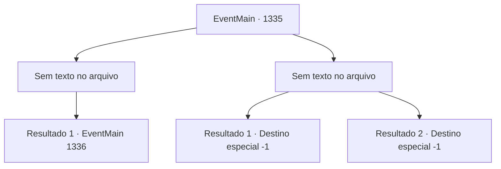

# Eventos principais · 1335

[Índice da tabela](index.md) · [Índice geral](../index.md)

ID: `pt:EventMain:1335` · Fonte: `EventMain4` · Versão: 1.2.47.

Mapeamento estático dos arquivos; a disponibilidade e a execução dependem do estado da run.

## Texto do evento

*Sem texto no arquivo.*

## Dados de entrada

```json
{
  "id": 1335,
  "grade": 1,
  "normalGoal": "",
  "required": ""
}
```

## Mapa das escolhas



## Escolhas e resultados

### Escolha 1

*Sem texto no arquivo; o papel dessa opção depende da interface do jogo.*

Requisitos e outros campos da escolha:

```json
{
  "required": ""
}
```

#### Resultado 1.1

Você derrota todos os soldados e entra no posto avançado. 

 "Os inimigos estão formando esquadrões na frente!"

 "Todos, ocupem as posições e mantenham a linha!"

 A atenção dos soldados da Aliança está toda voltada para a frente. Você monitora seus movimentos brevemente antes de se afastar. Você percebe uma tenda enorme, bem maior que as outras, colocada no ponto mais alto. Nela está uma bandeira com o brasão da Casa Greymoor - o grifo -. Ao lado, mais bandeiras, cada uma com o símbolo de uma cobra prateada, um urso amarelo e um arco vermelho. Casas da Aliança. Este deve ser o quartel-general da Aliança. Então, você percebe alguns cavaleiros saindo da tenda. Eles têm cada um sigilos únicos na cota peitoral. Eles correm em direção ao campo de batalha, conversando. 

 "Olha como estão desesperados - devem estar sem comida. Teremos uma vitória fácil se arrastarmos o cerco por mais tempo."

 Então, outro cavaleiro rebate. 

 "Isso não é verdade. Ouvi dizer que o Castelo Briovich tem pelo menos quatro meses de mantimentos. Sem falar que a época de plantio está chegando. Não devemos nos demorar."

 Você reconhece um rosto familiar ali. Você sabe o nome dele. Sir Wojciech. Um cavaleiro leal a Katrin, que serviu à Casa Greymoor desde o governo do seu pai. Wojciech parece perdido em pensamentos, ouvindo os outros cavaleiros em silêncio.

Continuação registrada: [Evento 1336](1336.md) na mesma tabela.

```json
{
  "required": "",
  "chance": "1",
  "nextEvent": 1336,
  "type": 2,
  "reward": ""
}
```

### Escolha 2

*Sem texto no arquivo; o papel dessa opção depende da interface do jogo.*

Requisitos e outros campos da escolha:

```json
{
  "required": ""
}
```

#### Resultado 2.1

Lanças são arremessadas contra você de todos os ângulos possíveis. Uma atinge seu pescoço. Sangue carmesim jorra da ferida. Você sente sua consciência se esvair. Você tenta se mover, mas seus membros não obedecem. Lamentavelmente, você sucumbe à dor, morrendo no chão.

Continuação registrada: [Destino especial `-1`](../destinos-especiais.md).

```json
{
  "required": "5_959_1",
  "chance": "1",
  "nextEvent": -1,
  "type": 2,
  "reward": "15_7_26|0_0_-1|0_1_-1|25_8_1"
}
```

#### Resultado 2.2

Lanças são arremessadas contra você de todos os ângulos possíveis. Uma atinge seu pescoço. Sangue carmesim jorra da ferida. Você sente sua consciência se esvair. Você tenta se mover, mas seus membros não obedecem. Lamentavelmente, você sucumbe à dor, morrendo no chão.

Continuação registrada: [Destino especial `-1`](../destinos-especiais.md).

```json
{
  "required": "18_959_1",
  "chance": "1",
  "nextEvent": -1,
  "type": 2,
  "reward": "15_7_11|0_0_-1|0_1_-1|25_8_1"
}
```

## Referências que chegam a este evento

- [Evento 1334 · escolha 1 · resultado 2](1334.md#escolha-1)
- [Evento 1334 · escolha 2 · resultado 2](1334.md#escolha-2)
- [Evento 1334 · escolha 3 · resultado 2](1334.md#escolha-3)
