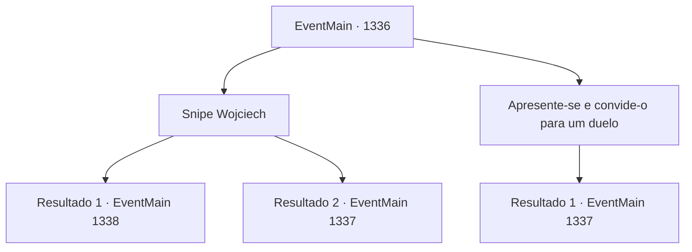

# Eventos principais · 1336

[Índice da tabela](index.md) · [Índice geral](../index.md)

ID: `pt:EventMain:1336` · Fonte: `EventMain4` · Versão: 1.2.47.

Mapeamento estático dos arquivos; a disponibilidade e a execução dependem do estado da run.

## Texto do evento

*Sem texto no arquivo.*

## Dados de entrada

```json
{
  "id": 1336,
  "grade": 1,
  "normalGoal": "",
  "required": ""
}
```

## Mapa das escolhas



## Escolhas e resultados

### Escolha 1

Snipe Wojciech

Requisitos e outros campos da escolha:

```json
{
  "required": "20_6_2"
}
```

#### Resultado 1.1

Os três cavaleiros estão ocupados debatendo estratégias, alheios ao que os cerca. Você mira em Wojciech, que ainda está perdido em pensamentos, e dispara de longe. 

 "Ack..!!"

 Mesmo um cavaleiro veterano não consegue reagir a um tiro vindo das sombras. Wojciech tropeça e cai no chão, o pescoço perfurado. 

 "Sir Wojciech! M-mostre-se, seu verme miserável!"

 Um dos dois cavaleiros levanta o escudo e olha ao redor, então te vê. 

 "AÍ!"

 Eles avançam imediatamente sobre você com suas espadas longas.

Continuação registrada: [Evento 1338](1338.md) na mesma tabela.

```json
{
  "required": "",
  "chance": "1|0_6_1",
  "nextEvent": 1338,
  "type": 0,
  "reward": "6_3_197|5_968_1",
  "place": 13
}
```

#### Resultado 1.2

Os três cavaleiros estão ocupados debatendo estratégias, alheios ao que os cerca. Você mira em Wojciech, que ainda está perdido em pensamentos, e dispara de longe. 

 "Tck...! Temos um arqueiro inimigo!!"

 O cavaleiro veterano consegue reagir ao tiro vindo da escuridão, desviando seu disparo. Enquanto Wojciech estremece com o impacto, os cavaleiros ao redor começam a ficar mais atentos ao ambiente. 

 "Sir Wojciech! M- mostre-se, seu verme desprezível!"

 Um dos dois cavaleiros ergue o escudo e olha ao redor, então avista você. 

 "LÁ!"

 Wojciech avança contra você primeiro. Os outros o seguem.

Continuação registrada: [Evento 1337](1337.md) na mesma tabela.

```json
{
  "required": "",
  "chance": "24",
  "nextEvent": 1337,
  "type": 1,
  "reward": "6_0_205",
  "place": 13
}
```

### Escolha 2

Apresente-se e convide-o para um duelo

Requisitos e outros campos da escolha:

```json
{
  "required": ""
}
```

#### Resultado 2.1

Você avança orgulhosamente na frente dos três cavaleiros. Surpresos com sua entrada repentina, os cavaleiros sacam suas espadas longas. 

 "Um Briovich...?!"

 "Como você entrou aqui?!"

 Você ignora os cavaleiros mais jovens e encara Wojciech. Ele faz um gesto para que os outros cavaleiros se afastem dois passos. 

 'RING-' 

 A espada longa desembainhada de Wojciech reflete a luz do sol. Sem dizer uma palavra, ele aponta a arma para você. Você desafia Wojciech para um duelo, mas ele recusa com um sorriso frio. 

 "Minhas desculpas, mas não tenho intenção de duelar com você."

 Você sente pura malícia em seus olhos. Instintivamente percebe que a conversa acabou. Wojciech ataca você primeiro. Os outros o seguem.

Continuação registrada: [Evento 1337](1337.md) na mesma tabela.

```json
{
  "required": "",
  "chance": "1",
  "nextEvent": 1337,
  "type": 2,
  "reward": "6_0_205",
  "place": 13
}
```

## Referências que chegam a este evento

- [Evento 1334 · escolha 1 · resultado 1](1334.md#escolha-1)
- [Evento 1334 · escolha 2 · resultado 1](1334.md#escolha-2)
- [Evento 1334 · escolha 3 · resultado 1](1334.md#escolha-3)
- [Evento 1335 · escolha 1 · resultado 1](1335.md#escolha-1)
