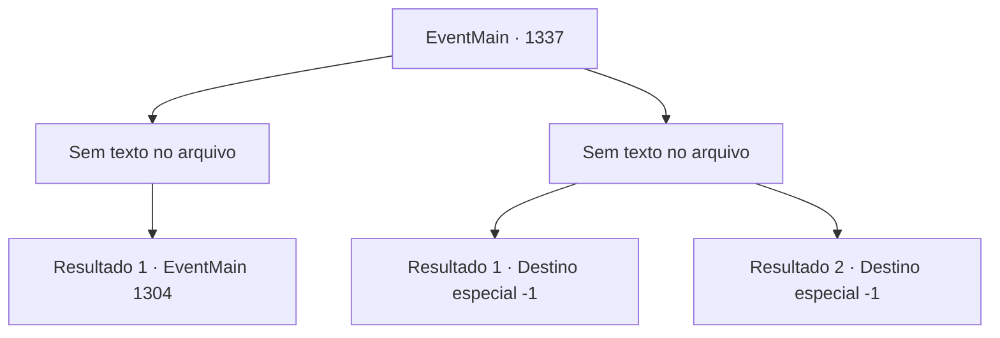

# Eventos principais · 1337

[Índice da tabela](index.md) · [Índice geral](../index.md)

ID: `pt:EventMain:1337` · Fonte: `EventMain4` · Versão: 1.2.47.

Mapeamento estático dos arquivos; a disponibilidade e a execução dependem do estado da run.

## Texto do evento

*Sem texto no arquivo.*

## Dados de entrada

```json
{
  "id": 1337,
  "grade": 1,
  "normalGoal": "",
  "required": ""
}
```

## Mapa das escolhas



## Escolhas e resultados

### Escolha 1

*Sem texto no arquivo; o papel dessa opção depende da interface do jogo.*

Requisitos e outros campos da escolha:

```json
{
  "required": ""
}
```

#### Resultado 1.1

Wojciech resiste até o último suspiro, mas no fim não é páreo para você. Você põe fim à vida dele e olha ao redor. Os dois cavaleiros que atacaram você junto com ele já estão caídos no chão, sem vida. Você respira fundo e segue para o quartel-general. Lá dentro, encontra uma pilha de documentos vitais para a guerra. Você pega uma tocha próxima e ateia fogo na tenda. A chama se espalha rapidamente, e uma fumaça negra sobe para o céu. 

 "F- FOGO!!"

 Enquanto os soldados da Aliança entram em pânico, você deixa o posto avançado. Em seguida, você se reúne com seus soldados novamente. A Aliança, tendo perdido seu comandante, nem oferece uma boa resistência antes de ser completamente destruída por seus exércitos. Infelizmente, eles começam a se dispersar e fugir. Depois que a luta termina, Rennart se aproxima de você. 

 "Meu Senhor."

 Ele faz uma breve reverência antes de lhe dar um relatório. 

 "Trancamos os prisioneiros na cadeia. Nossos soldados estão encontrando e reivindicando suprimentos e armamentos. Os sobreviventes da Aliança estão sendo localizados agora mesmo."

 Você dá aos seus soldados uma curta pausa, então parte direto para o Castelo Greymoor. Você sabe que enquanto o líder da Aliança, a Casa Greymoor, permanecer intacta, a guerra nunca terminará. Alguns dias depois, você chega ao Castelo Greymoor, apenas para encontrar seus portões frontais fechados em silêncio. Os portões estão trancados, e os soldados no alto das muralhas do castelo olham para você com nervosismo.

Continuação registrada: [Evento 1304](1304.md) na mesma tabela.

```json
{
  "required": "",
  "chance": "1",
  "nextEvent": 1304,
  "type": 2,
  "reward": "5_968_1"
}
```

### Escolha 2

*Sem texto no arquivo; o papel dessa opção depende da interface do jogo.*

Requisitos e outros campos da escolha:

```json
{
  "required": ""
}
```

#### Resultado 2.1

Um impacto poderoso vibra por todo o seu corpo. Wojciech aproveita a oportunidade e lhe desfere uma estocada com sua espada longa. O aço frio perfura seu peito. Você fica de joelhos e cai no chão, sem vida.

Continuação registrada: [Destino especial `-1`](../destinos-especiais.md).

```json
{
  "required": "5_959_1",
  "chance": "1",
  "nextEvent": -1,
  "type": 2,
  "reward": "0_0_-1|0_1_-1|15_7_26|25_8_1"
}
```

#### Resultado 2.2

Um impacto poderoso vibra por todo o seu corpo. Wojciech aproveita a oportunidade e lhe desfere uma estocada com sua espada longa. O aço frio perfura seu peito. Você fica de joelhos e cai no chão, sem vida.

Continuação registrada: [Destino especial `-1`](../destinos-especiais.md).

```json
{
  "required": "18_959_1",
  "chance": "1",
  "nextEvent": -1,
  "type": 2,
  "reward": "0_0_-1|0_1_-1|15_7_11|25_8_1"
}
```

## Referências que chegam a este evento

- [Evento 1336 · escolha 1 · resultado 2](1336.md#escolha-1)
- [Evento 1336 · escolha 2 · resultado 1](1336.md#escolha-2)
