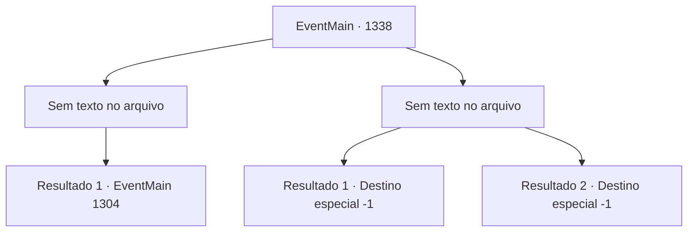

# Eventos principais · 1338

[Índice da tabela](index.md) · [Índice geral](../index.md)

ID: `pt:EventMain:1338` · Fonte: `EventMain4` · Versão: 1.2.47.

Mapeamento estático dos arquivos; a disponibilidade e a execução dependem do estado da run.

## Texto do evento

*Sem texto no arquivo.*

## Dados de entrada

```json
{
  "id": 1338,
  "grade": 1,
  "normalGoal": "",
  "required": ""
}
```

## Mapa das escolhas



## Escolhas e resultados

### Escolha 1

*Sem texto no arquivo; o papel dessa opção depende da interface do jogo.*

Requisitos e outros campos da escolha:

```json
{
  "required": ""
}
```

#### Resultado 1.1

Você luta com os dois cavaleiros e depois se aproxima de Wojciech. Seus olhos já estão sem vida. Você respira fundo e segue para o quartel-general. Lá dentro, encontra uma pilha de documentos vitais para a guerra. Você pega uma tocha próxima e ateia fogo na tenda. A chama se espalha rapidamente, e fumaça preta sobe para o céu. 

 "F- FOGO!!"

 Enquanto os soldados da Aliança entram em pânico, você deixa o posto avançado. Em seguida, você se reúne com seus soldados mais uma vez. A Aliança, tendo perdido seu comandante, nem oferece boa resistência antes de ser completamente destruída pelos seus exércitos. Infelizmente, eles começam a se dispersar e fugir. Depois que a luta termina, Rennart se aproxima de você. 

 "Meu senhor."

 Ele se curva brevemente antes de lhe dar um relatório. 

 "Trancamos os prisioneiros na prisão. Nossos soldados estão encontrando e apreendendo suprimentos e armamentos. Sobreviventes da Aliança estão sendo procurados enquanto falamos."

 Você dá aos seus soldados uma breve pausa, então segue direto para o Castelo Greymoor. Você sabe que enquanto o líder da Aliança, a Casa Greymoor, permanecer intacta, a guerra nunca terminará. Alguns dias depois, você chega ao Castelo Greymoor, apenas para encontrar seus portões da frente fechados em silêncio. Os portões estão trancados firmemente, e os soldados no topo das muralhas do castelo olham para você nervosamente.

Continuação registrada: [Evento 1304](1304.md) na mesma tabela.

```json
{
  "required": "",
  "chance": "1",
  "nextEvent": 1304,
  "type": 2,
  "reward": "5_968_1"
}
```

### Escolha 2

*Sem texto no arquivo; o papel dessa opção depende da interface do jogo.*

Requisitos e outros campos da escolha:

```json
{
  "required": ""
}
```

#### Resultado 2.1

Você é atingido na testa por um escudo resistente. Sua visão embaça com o impacto. Você perde o equilíbrio por um instante. Os cavaleiros aproveitam a oportunidade. Uma saraivada de ataques vem contra você, acertando seu ombro e sua coxa. 

 "*ofeg*... *ofeg*... Finalmente acabou. Como está Sir Wojciech?"

 Os cavaleiros checam seu pulso e voltam para você. 

 "...Ele faleceu."

 Eles voltam até você com a espada longa dele nas mãos, buscando vingança. Com um único golpe, sua cabeça é separada do corpo. O corpo decapitado cai ao chão, e sua visão gira e gira antes de ficar escura.

Continuação registrada: [Destino especial `-1`](../destinos-especiais.md).

```json
{
  "required": "5_959_1",
  "chance": "1",
  "nextEvent": -1,
  "type": 2,
  "reward": "0_0_-1|0_1_-1|15_7_26|25_8_1"
}
```

#### Resultado 2.2

Você é atingido na testa por um escudo resistente. Sua visão embaça com o impacto. Você perde o equilíbrio por um instante. Os cavaleiros aproveitam a oportunidade. Uma saraivada de ataques vem contra você, acertando seu ombro e sua coxa. 

 "*ofeg*... *ofeg*... Finalmente acabou. Como está Sir Wojciech?"

 Os cavaleiros checam seu pulso e voltam para você. 

 "...Ele faleceu."

 Eles voltam até você com a espada longa dele nas mãos, buscando vingança. Com um único golpe, sua cabeça é separada do corpo. O corpo decapitado cai ao chão, e sua visão gira e gira antes de ficar escura.

Continuação registrada: [Destino especial `-1`](../destinos-especiais.md).

```json
{
  "required": "18_959_1",
  "chance": "1",
  "nextEvent": -1,
  "type": 2,
  "reward": "0_0_-1|0_1_-1|15_7_11|25_8_1"
}
```

## Referências que chegam a este evento

- [Evento 1336 · escolha 1 · resultado 1](1336.md#escolha-1)
