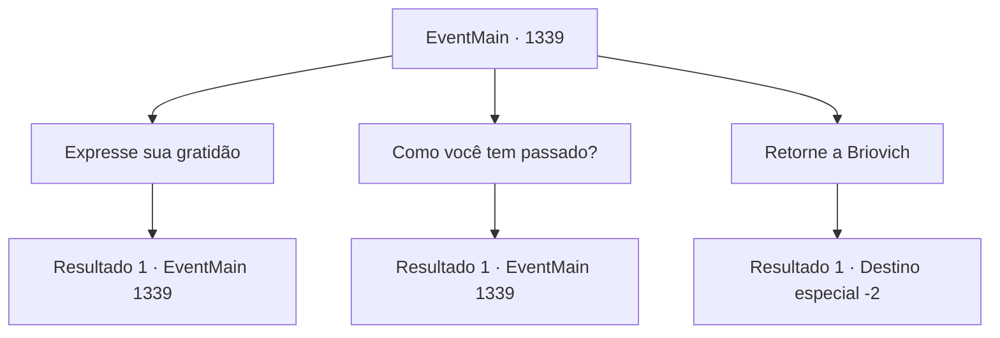

# Eventos principais · 1339

[Índice da tabela](index.md) · [Índice geral](../index.md)

ID: `pt:EventMain:1339` · Fonte: `EventMain4` · Versão: 1.2.47.

Mapeamento estático dos arquivos; a disponibilidade e a execução dependem do estado da run.

## Texto do evento

*Sem texto no arquivo.*

## Dados de entrada

```json
{
  "id": 1339,
  "grade": 1,
  "normalGoal": "",
  "required": ""
}
```

## Mapa das escolhas



## Escolhas e resultados

### Escolha 1

Expresse sua gratidão

Requisitos e outros campos da escolha:

```json
{
  "required": "5_974_0"
}
```

#### Resultado 1.1

Você expressou brevemente sua gratidão. Katrin sorriu discretamente e assentiu. 

 "Não há de quê. Como eu disse ontem, graças a Briovich, temos conseguido viver em segurança, então espero que você não se sinta em dívida demais conosco."


Continuação registrada: [Evento 1339](1339.md) na mesma tabela.

```json
{
  "required": "",
  "chance": "1",
  "nextEvent": 1339,
  "type": 2,
  "reward": "5_974_1"
}
```

### Escolha 2

Como você tem passado?

Requisitos e outros campos da escolha:

```json
{
  "required": "5_975_0"
}
```

#### Resultado 2.1

Você perguntou como ela havia passado todo esse tempo. Katrin assentiu levemente. 

 "Ah, sim... Tenho passado bem. Estive tão ocupada que não tive a oportunidade de entrar em contato com você."


Continuação registrada: [Evento 1339](1339.md) na mesma tabela.

```json
{
  "required": "",
  "chance": "1",
  "nextEvent": 1339,
  "type": 2,
  "reward": "5_975_1"
}
```

### Escolha 3

Retorne a Briovich

Requisitos e outros campos da escolha:

```json
{
  "required": ""
}
```

#### Resultado 3.1


 "Então, tenha uma viagem segura de volta."

 Vocês se despediram, e você seguiu em direção à cidade. Assim como no dia anterior, o som do ferro sendo martelado ecoava da ferraria, e o aroma de pão recém-assado vinha da padaria. Crianças corriam pelos becos. Você passou por aquela paisagem familiar e seguiu para além das muralhas externas. Os soldados prestaram continência enquanto você atravessava o portão, e você ergueu levemente a mão em resposta. Então, partiu pela estrada de volta a Briovich.

Continuação registrada: [Destino especial `-2`](../destinos-especiais.md).

```json
{
  "required": "",
  "chance": "1",
  "nextEvent": -2,
  "type": 2,
  "reward": "13_6_3"
}
```

## Referências que chegam a este evento

- [Evento 1077 · escolha 1 · resultado 1](1077.md#escolha-1)
- [Evento 1079 · escolha 1 · resultado 1](1079.md#escolha-1)
- [Evento 1080 · escolha 1 · resultado 1](1080.md#escolha-1)
- [Evento 1339 · escolha 1 · resultado 1](1339.md#escolha-1)
- [Evento 1339 · escolha 2 · resultado 1](1339.md#escolha-2)
