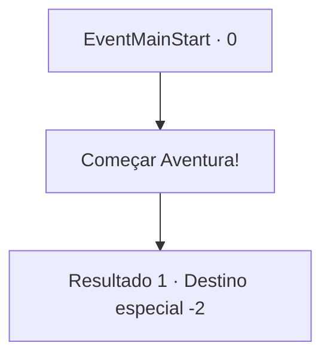

# Inícios de aventura · 0

[Índice da tabela](index.md) · [Índice geral](../index.md)

ID: `pt:EventMainStart:0` · Fonte: `EventMainStart4` · Versão: 1.2.47.

Mapeamento estático dos arquivos; a disponibilidade e a execução dependem do estado da run.

## Texto do evento

<Aspirante a Grande Aventureiro>

 Ao som de uma magnífica trombeta, um indivíduo de aparência forte foi escoltado para uma plataforma. O indivíduo lentamente se ajoelhou diante do rei. 

 "Todos no reino se lembrarão de sua aventura. Olhem para ele, senhoras e senhores! Este aventureiro aqui é o herói do nosso país!"|drawing_prize|Com o decreto do rei, a multidão ovacionou o herói. Desde que você testemunhou o evento com seus próprios olhos, você sonhou em se tornar um aventureiro honrado, ao invés herdar a fazenda de seu pai. Anos se passaram, e esse sonho ainda está em seu coração. Finalmente, ele o levou a começar sua própria aventura.

## Dados de entrada

```json
{
  "id": 0,
  "grade": 1,
  "place": "",
  "required": ""
}
```

## Mapa das escolhas



## Escolhas e resultados

### Escolha 1

Começar Aventura!

Requisitos e outros campos da escolha:

```json
{
  "required": ""
}
```

#### Resultado 1.1

*Sem texto no arquivo.*

Continuação registrada: [Destino especial `-2`](../destinos-especiais.md).

```json
{
  "required": "",
  "chance": "1",
  "nextEvent": -2,
  "type": 2,
  "reward": "13_0_0|0_4_10|5_215_1"
}
```

## Referências que chegam a este evento

Nenhum `nextEvent` positivo da mesma tabela aponta para este nó. Isso não prova que seja inacessível: sorteio e estado de história podem selecioná-lo.

