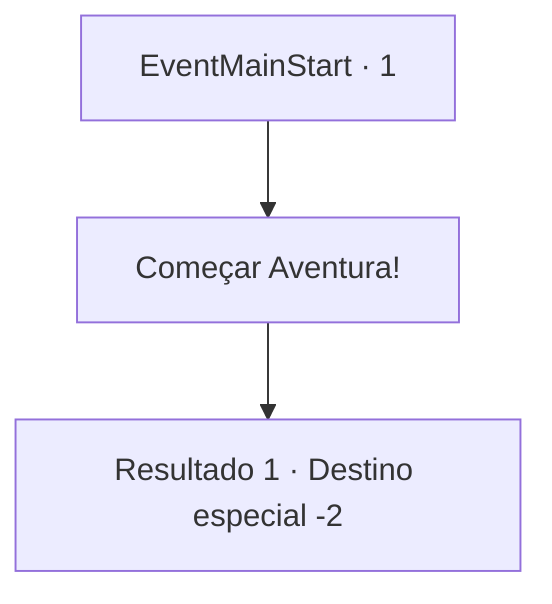

# Inícios de aventura · 1

[Índice da tabela](index.md) · [Índice geral](../index.md)

ID: `pt:EventMainStart:1` · Fonte: `EventMainStart4` · Versão: 1.2.47.

Mapeamento estático dos arquivos; a disponibilidade e a execução dependem do estado da run.

## Texto do evento

<Um Aprendiz Exilado>
 |drawing_exile|Você foi exilado da Torre da Magia, falsamente acusado de tentar roubar o Tomo Proibido. Você era o único que sabia quem era a verdadeira culpada, mas ninguém acreditou em você. Isso aconteceu porque aquela que você alegou ser a culpada foi uma das melhores alunas da história da Torre da Magia. Você sabia que a única maneira de se vingar era se tornar um mago ainda melhor do que ela. Assim, você começou uma aventura para se tornar o maior mago de todos os tempos.

## Dados de entrada

```json
{
  "id": 1,
  "grade": 1,
  "place": "",
  "required": ""
}
```

## Mapa das escolhas



## Escolhas e resultados

### Escolha 1

Começar Aventura!

Requisitos e outros campos da escolha:

```json
{
  "required": ""
}
```

#### Resultado 1.1

*Sem texto no arquivo.*

Continuação registrada: [Destino especial `-2`](../destinos-especiais.md).

```json
{
  "required": "",
  "chance": "1",
  "nextEvent": -2,
  "type": 2,
  "reward": "13_1_0|0_4_10|5_216_1"
}
```

## Referências que chegam a este evento

Nenhum `nextEvent` positivo da mesma tabela aponta para este nó. Isso não prova que seja inacessível: sorteio e estado de história podem selecioná-lo.

