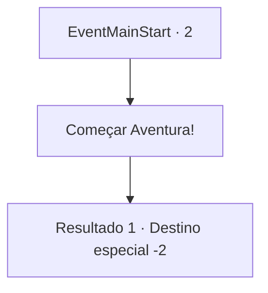

# Inícios de aventura · 2

[Índice da tabela](index.md) · [Índice geral](../index.md)

ID: `pt:EventMainStart:2` · Fonte: `EventMainStart4` · Versão: 1.2.47.

Mapeamento estático dos arquivos; a disponibilidade e a execução dependem do estado da run.

## Texto do evento

<Bibliotecário ao Resgate da Princesa>

 Você era o bibliotecário real do Império de Zaipent. Um dia, uma senhorita com uma aura brilhante entrou na biblioteca. |drawing_princess| Ela se apresentou como a princesa 'Esit' e lhe fez uma pergunta. 

 "Você poderia gentilmente... me recomendar um livro?"

 Alguns anos se passaram desde então. A princesa visitava regularmente a biblioteca para ler livros, conversar com a princesa sobre literatura tornou-se parte de sua vida diária. Um dia, uma sombra gigante apareceu do lado de fora da janela. Em seguida, um tremor por todo o castelo, como se um terremoto tivesse ocorrido. Ao olhar para fora você vê um enorme dragão cinza, raptando a princesa e fugindo. Você não conhecia o mundo exterior, mas, sem pensar, rapidamente correu para fora do castelo.

## Dados de entrada

```json
{
  "id": 2,
  "grade": 1,
  "place": "",
  "required": ""
}
```

## Mapa das escolhas



## Escolhas e resultados

### Escolha 1

Começar Aventura!

Requisitos e outros campos da escolha:

```json
{
  "required": ""
}
```

#### Resultado 1.1

*Sem texto no arquivo.*

Continuação registrada: [Destino especial `-2`](../destinos-especiais.md).

```json
{
  "required": "",
  "chance": "1",
  "nextEvent": -2,
  "type": 2,
  "reward": "13_2_0|0_4_10|5_153_1"
}
```

## Referências que chegam a este evento

Nenhum `nextEvent` positivo da mesma tabela aponta para este nó. Isso não prova que seja inacessível: sorteio e estado de história podem selecioná-lo.

