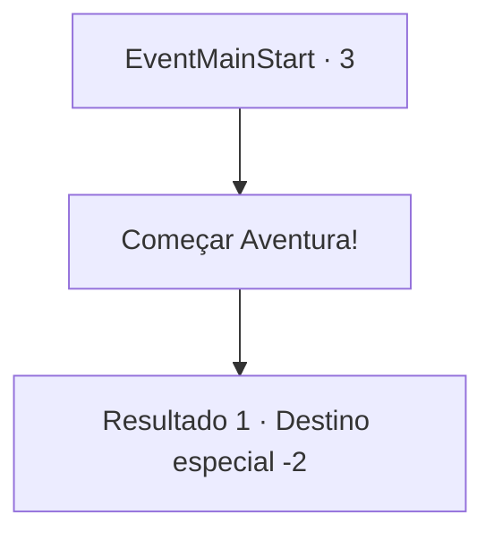

# Inícios de aventura · 3

[Índice da tabela](index.md) · [Índice geral](../index.md)

ID: `pt:EventMainStart:3` · Fonte: `EventMainStart4` · Versão: 1.2.47.

Mapeamento estático dos arquivos; a disponibilidade e a execução dependem do estado da run.

## Texto do evento

<Um Ciclo de Dívidas>

 No dia em que seus pais faleceram, um homem de cabelos longos veio até você. Ele estava acompanhado por dois capangas, e com uma voz tranquila, olhando para você de cima, ele falou. 

 "Vê isso? Isso é um certificado que prova a dívida de seus pais."

 Ele ordenou que seus capangas trouxessem sua irmã 'Fiana'. Então, examinando seu rosto, ele disse, |drawing_hostage| 

 "Vou mantê-la como garantia até que você pague essa dívida. Se quiser ela de volta é melhor me trazer ouro e rápido. Vá... mate um dragão ou algo assim. Apenas tente."

 Com essas palavras, você acordou de um sonho. Você desejava que tudo fosse apenas um pesadelo, mas era sua realidade. Conforme o dia amanhecia e um vento frio soprava, você levanta da cama, toma um rápido café da manhã, e vai em busca de sua irmã.

## Dados de entrada

```json
{
  "id": 3,
  "grade": 1,
  "place": "",
  "required": ""
}
```

## Mapa das escolhas



## Escolhas e resultados

### Escolha 1

Começar Aventura!

Requisitos e outros campos da escolha:

```json
{
  "required": ""
}
```

#### Resultado 1.1

*Sem texto no arquivo.*

Continuação registrada: [Destino especial `-2`](../destinos-especiais.md).

```json
{
  "required": "",
  "chance": "1",
  "nextEvent": -2,
  "type": 2,
  "reward": "13_3_0|0_4_10|5_242_1"
}
```

## Referências que chegam a este evento

Nenhum `nextEvent` positivo da mesma tabela aponta para este nó. Isso não prova que seja inacessível: sorteio e estado de história podem selecioná-lo.

