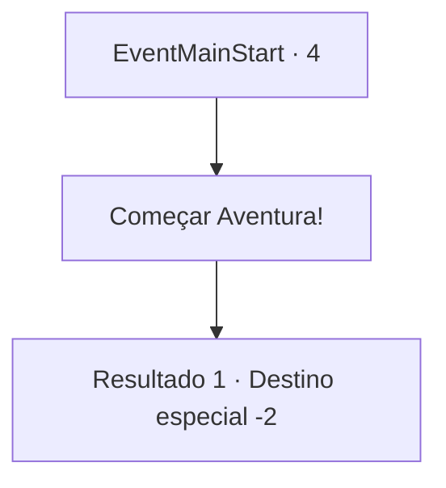

# Inícios de aventura · 4

[Índice da tabela](index.md) · [Índice geral](../index.md)

ID: `pt:EventMainStart:4` · Fonte: `EventMainStart4` · Versão: 1.2.47.

Mapeamento estático dos arquivos; a disponibilidade e a execução dependem do estado da run.

## Texto do evento

<Toque do demônio>

 Lutando por sua vida moribunda nas chamas ardentes, você procura vingança desesperadamente. Naquele momento, você ouviu a voz de alguém em seu ouvido. |drawing_demon| 

 "Vingança? Muito bem... Vamos fazer um trato, eu vou te dar parte do meu poder e, em troca... você irá MATAR seus inimigos e trazer todas as suas almas a mim."

 O demônio estendeu a mão de forma gentil e sedutora, você aceita e agarra sua mão com força. O  Por seu cônjuge que cuidou de você com uma doença profunda. Por seu filho de sete anos que morreu queimado sem nem saber como morreu. Para vingar sua família que foi queimada na fogueira como 'adoradores de demônios' por Teresianos fanáticos.

## Dados de entrada

```json
{
  "id": 4,
  "grade": 1,
  "place": "",
  "required": ""
}
```

## Mapa das escolhas



## Escolhas e resultados

### Escolha 1

Começar Aventura!

Requisitos e outros campos da escolha:

```json
{
  "required": ""
}
```

#### Resultado 1.1

*Sem texto no arquivo.*

Continuação registrada: [Destino especial `-2`](../destinos-especiais.md).

```json
{
  "required": "",
  "chance": "1",
  "nextEvent": -2,
  "type": 2,
  "reward": "13_4_0|0_4_10|5_432_1|0_5_1|0_6_1|0_13_1|0_3_-50"
}
```

## Referências que chegam a este evento

Nenhum `nextEvent` positivo da mesma tabela aponta para este nó. Isso não prova que seja inacessível: sorteio e estado de história podem selecioná-lo.

