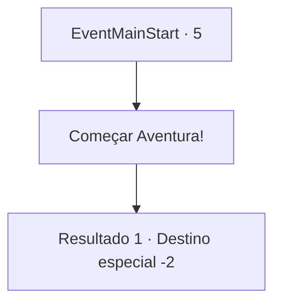

# Inícios de aventura · 5

[Índice da tabela](index.md) · [Índice geral](../index.md)

ID: `pt:EventMainStart:5` · Fonte: `EventMainStart4` · Versão: 1.2.47.

Mapeamento estático dos arquivos; a disponibilidade e a execução dependem do estado da run.

## Texto do evento

<A Desaparição do Professor Naverr>

 Você é um aprendiz do Professor Naverr da Universidade de Brikkalua, refletindo sobre o seu ensaio. Então, o Diretor se aproxima de você, dizendo que a universidade não tem notícias de Naverr há dias. |drawing_searchnaverr| 

 "Me pergunto o que ele está aprontando desta vez... Devo pedir que você o encontre."

 Segundo ele, a última carta de Naverr foi enviada de algum lugar perto de Darval. Você responde imediatamente com um 'Sim, senhor', levantando-se da sua cadeira.

## Dados de entrada

```json
{
  "id": 5,
  "grade": 1,
  "place": "",
  "required": ""
}
```

## Mapa das escolhas



## Escolhas e resultados

### Escolha 1

Começar Aventura!

Requisitos e outros campos da escolha:

```json
{
  "required": ""
}
```

#### Resultado 1.1

*Sem texto no arquivo.*

Continuação registrada: [Destino especial `-2`](../destinos-especiais.md).

```json
{
  "required": "",
  "chance": "1",
  "nextEvent": -2,
  "type": 2,
  "reward": "13_5_0|0_4_10|5_699_1"
}
```

## Referências que chegam a este evento

Nenhum `nextEvent` positivo da mesma tabela aponta para este nó. Isso não prova que seja inacessível: sorteio e estado de história podem selecioná-lo.

