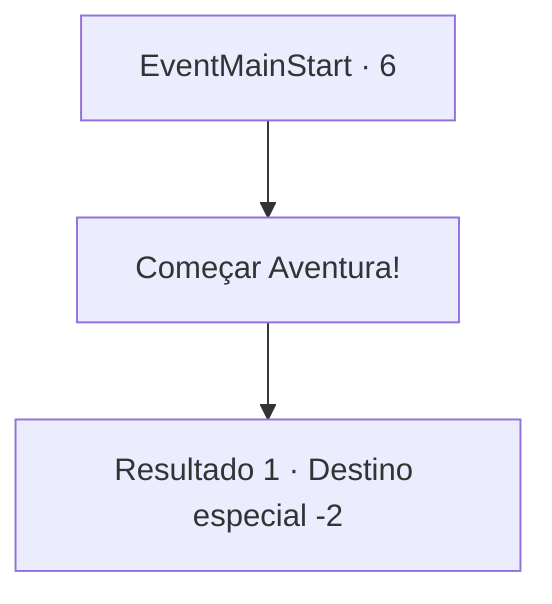

# Inícios de aventura · 6

[Índice da tabela](index.md) · [Índice geral](../index.md)

ID: `pt:EventMainStart:6` · Fonte: `EventMainStart4` · Versão: 1.2.47.

Mapeamento estático dos arquivos; a disponibilidade e a execução dependem do estado da run.

## Texto do evento

<A Pequena Coroa Sobre as Cinzas> |drawing_ashenCoronet| Seu pai não lhe deixou um legado glorioso, mas uma pilha de cinzas. A posse e o controle do condado de Briovich que você herdou pareciam mais uma maldição do que uma bênção. Celeiros vazios rangiam enquanto o vento passava por eles. As terras agrícolas estavam murchas, há muito tempo sem sua última colheita. Seus súditos e camponeses mal conseguiam se manter vivos, esmagados pelo desânimo e pela fome. O nome de sua Casa agora era uma coleira, arrastando sua honra para baixo. Mas você se recusou a desviar o olhar. Aceitando com dignidade os gritos de sua propriedade em ruínas, você jurou a si mesmo mudar o rumo desta tragédia.

## Dados de entrada

```json
{
  "id": 6,
  "grade": 1,
  "place": "",
  "required": ""
}
```

## Mapa das escolhas



## Escolhas e resultados

### Escolha 1

Começar Aventura!

Requisitos e outros campos da escolha:

```json
{
  "required": ""
}
```

#### Resultado 1.1

*Sem texto no arquivo.*

Continuação registrada: [Destino especial `-2`](../destinos-especiais.md).

```json
{
  "required": "",
  "chance": "1",
  "nextEvent": -2,
  "type": 2,
  "reward": "13_6_0|0_4_50|5_976_1"
}
```

## Referências que chegam a este evento

Nenhum `nextEvent` positivo da mesma tabela aponta para este nó. Isso não prova que seja inacessível: sorteio e estado de história podem selecioná-lo.

