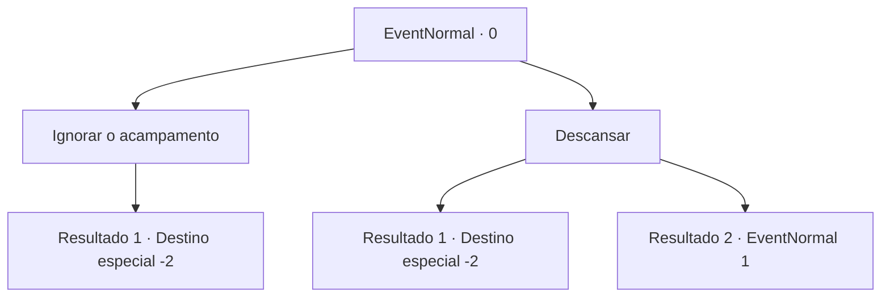

# Eventos normais · 0

[Índice da tabela](index.md) · [Índice geral](../index.md)

ID: `pt:EventNormal:0` · Fonte: `EventNormal4` · Versão: 1.2.47.

Mapeamento estático dos arquivos; a disponibilidade e a execução dependem do estado da run.

## Texto do evento

|drawing_camp|Você encontra o que sobrou do acampamento de alguém. Você pensa que poderia descansar um pouco.

## Dados de entrada

```json
{
  "id": 0,
  "grade": 1,
  "place": "",
  "required": ""
}
```

## Mapa das escolhas



## Escolhas e resultados

### Escolha 1

Ignorar o acampamento

Requisitos e outros campos da escolha:

```json
{
  "required": ""
}
```

#### Resultado 1.1

Você passa pelo acampamento.

Continuação registrada: [Destino especial `-2`](../destinos-especiais.md).

```json
{
  "required": "",
  "chance": "1",
  "nextEvent": -2,
  "type": 2,
  "reward": ""
}
```

### Escolha 2

Descansar

Requisitos e outros campos da escolha:

```json
{
  "required": ""
}
```

#### Resultado 2.1

Você decide fazer uma pausa.  Você reacende a fogueira e tira uma soneca na tenda.

Continuação registrada: [Destino especial `-2`](../destinos-especiais.md).

```json
{
  "required": "",
  "chance": "2",
  "nextEvent": -2,
  "type": 2,
  "reward": "0_0_1|0_1_1|0_2_1"
}
```

#### Resultado 2.2

Você decide fazer uma pausa.  Você reacende a fogueira e tira uma soneca na tenda.  Mas você não pode descansar por muito tempo.  Algo morde seu pé e o arrasta para fora.

Continuação registrada: [Evento 1](0001.md) na mesma tabela.

```json
{
  "required": "",
  "chance": "1",
  "nextEvent": 1,
  "type": 2,
  "reward": "6_0_27",
  "place": 14
}
```

## Referências que chegam a este evento

Nenhum `nextEvent` positivo da mesma tabela aponta para este nó. Isso não prova que seja inacessível: sorteio e estado de história podem selecioná-lo.

