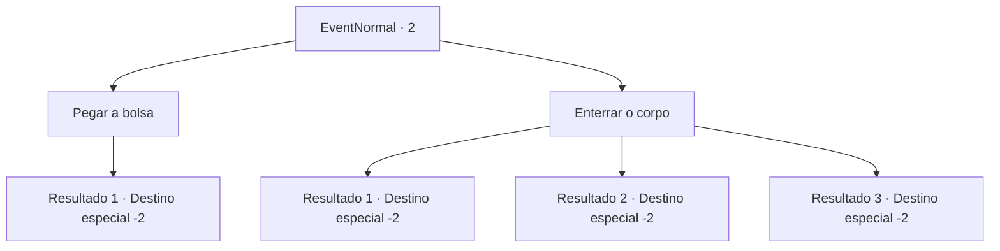

# Eventos normais · 2

[Índice da tabela](index.md) · [Índice geral](../index.md)

ID: `pt:EventNormal:2` · Fonte: `EventNormal4` · Versão: 1.2.47.

Mapeamento estático dos arquivos; a disponibilidade e a execução dependem do estado da run.

## Texto do evento

Você encontra uma bolsa abandonada.  O problema é que um cadáver a está abraçando com força.

## Dados de entrada

```json
{
  "id": 2,
  "grade": 1,
  "place": "",
  "required": ""
}
```

## Mapa das escolhas



## Escolhas e resultados

### Escolha 1

Pegar a bolsa

Requisitos e outros campos da escolha:

```json
{
  "required": ""
}
```

#### Resultado 1.1

Já que seu dono anterior está morto,  você decide fazer bom uso da bolsa e de seu conteúdo em nome do falecido.

Continuação registrada: [Destino especial `-2`](../destinos-especiais.md).

```json
{
  "required": "",
  "chance": "1",
  "nextEvent": -2,
  "type": 2,
  "reward": "0_4_1|3_0_1|3_42_1|0_3_-2|0_2_1"
}
```

### Escolha 2

Enterrar o corpo

Requisitos e outros campos da escolha:

```json
{
  "required": "1_0_2"
}
```

#### Resultado 2.1

Você cava um buraco no chão com suas próprias mãos e enterra o corpo e a bolsa. Você não sabe quem ele era, mas espera que descanse em paz.

Continuação registrada: [Destino especial `-2`](../destinos-especiais.md).

```json
{
  "required": "10_38_1",
  "chance": "3",
  "nextEvent": -2,
  "type": 2,
  "reward": "0_3_1|0_2_1"
}
```

#### Resultado 2.2

Você começa a cavar um buraco no chão com suas próprias mãos, esperando que ele possa descansar em paz, seja ele quem for.  Então você quebra sua unha em uma rocha protuberante.  Você agarra seu dedo sangrando de dor.  Você não pode terminar de enterrá-lo e tem que ir embora.

Continuação registrada: [Destino especial `-2`](../destinos-especiais.md).

```json
{
  "required": "10_38_1",
  "chance": "1",
  "nextEvent": -2,
  "type": 2,
  "reward": "0_3_1|0_0_-1|0_2_1"
}
```

#### Resultado 2.3

Você cava um buraco no chão com suas próprias mãos e enterra o corpo e a bolsa.  Você não sabe quem ele era, mas espera que descanse em paz.

Continuação registrada: [Destino especial `-2`](../destinos-especiais.md).

```json
{
  "required": "8_38_1",
  "chance": "1",
  "nextEvent": -2,
  "type": 2,
  "reward": "0_2_1"
}
```

## Referências que chegam a este evento

Nenhum `nextEvent` positivo da mesma tabela aponta para este nó. Isso não prova que seja inacessível: sorteio e estado de história podem selecioná-lo.

