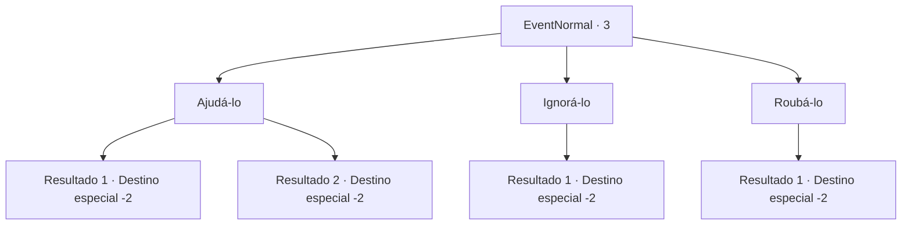

# Eventos normais · 3

[Índice da tabela](index.md) · [Índice geral](../index.md)

ID: `pt:EventNormal:3` · Fonte: `EventNormal4` · Versão: 1.2.47.

Mapeamento estático dos arquivos; a disponibilidade e a execução dependem do estado da run.

## Texto do evento

|drawing_herbalist| Você se depara com um herbalista errante. 

 "Oh, graças aos céus... Eu pensei que estava acabado..."

 Ele parece não comer ou dormir direito há dias.

## Dados de entrada

```json
{
  "id": 3,
  "grade": 1,
  "place": "",
  "required": "5_60_0"
}
```

## Mapa das escolhas



## Escolhas e resultados

### Escolha 1

Ajudá-lo

Requisitos e outros campos da escolha:

```json
{
  "required": ""
}
```

#### Resultado 1.1

Você diz a ele o caminho de volta para a cidade e entrega-lhe algum dinheiro.  Ele se curva em gratidão e vai embora.

Continuação registrada: [Destino especial `-2`](../destinos-especiais.md).

```json
{
  "required": "1_4_1",
  "chance": "1",
  "nextEvent": -2,
  "type": 2,
  "reward": "0_3_3|0_4_-1|0_2_1|5_60_1"
}
```

#### Resultado 1.2

Você diz a ele o caminho de volta para a cidade. Ele se curva em gratidão e vai embora.

Continuação registrada: [Destino especial `-2`](../destinos-especiais.md).

```json
{
  "required": "2_4_1",
  "chance": "1",
  "nextEvent": -2,
  "type": 2,
  "reward": "0_3_1|0_2_1|5_60_1"
}
```

### Escolha 2

Ignorá-lo

Requisitos e outros campos da escolha:

```json
{
  "required": ""
}
```

#### Resultado 2.1

O herbalista te chama desesperadamente, mas você o ignora.

Continuação registrada: [Destino especial `-2`](../destinos-especiais.md).

```json
{
  "required": "",
  "chance": "1",
  "nextEvent": -2,
  "type": 2,
  "reward": "0_3_-1|0_2_1"
}
```

### Escolha 3

Roubá-lo

Requisitos e outros campos da escolha:

```json
{
  "required": ""
}
```

#### Resultado 3.1

Você agride o herbalista e rouba seus pertences.

Continuação registrada: [Destino especial `-2`](../destinos-especiais.md).

```json
{
  "required": "",
  "chance": "1",
  "nextEvent": -2,
  "type": 2,
  "reward": "0_3_-5|0_4_5|0_2_1"
}
```

## Referências que chegam a este evento

Nenhum `nextEvent` positivo da mesma tabela aponta para este nó. Isso não prova que seja inacessível: sorteio e estado de história podem selecioná-lo.

