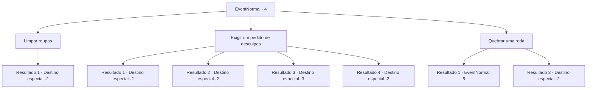

# Eventos normais · 4

[Índice da tabela](index.md) · [Índice geral](../index.md)

ID: `pt:EventNormal:4` · Fonte: `EventNormal4` · Versão: 1.2.47.

Mapeamento estático dos arquivos; a disponibilidade e a execução dependem do estado da run.

## Texto do evento

Uma carruagem passa em um dia chuvoso, jogando lama em sua direção. Você fica coberto de lama, mas o cocheiro continua sua viagem.

## Dados de entrada

```json
{
  "id": 4,
  "grade": 1,
  "place": "",
  "required": ""
}
```

## Mapa das escolhas



## Escolhas e resultados

### Escolha 1

Limpar roupas

Requisitos e outros campos da escolha:

```json
{
  "required": ""
}
```

#### Resultado 1.1

Você está ofendido, mas você simplesmente limpa a lama de suas roupas

Continuação registrada: [Destino especial `-2`](../destinos-especiais.md).

```json
{
  "required": "",
  "chance": "1",
  "nextEvent": -2,
  "type": 2,
  "reward": "0_3_1"
}
```

### Escolha 2

Exigir um pedido de desculpas

Requisitos e outros campos da escolha:

```json
{
  "required": ""
}
```

#### Resultado 2.1

Você para a carruagem e pede que o motorista se desculpe. Ele franze a testa e grita. 

 "Que diabos? Sai da frente, seu vagabundo sem-teto!"

 Ele aperta as rédeas e sai cavalgando. Mais lama vem em sua direção. 

Continuação registrada: [Destino especial `-2`](../destinos-especiais.md).

```json
{
  "required": "1_1_2|2_2_50",
  "chance": "5",
  "nextEvent": -2,
  "type": 1,
  "reward": "0_1_-1"
}
```

#### Resultado 2.2

Você para a carruagem e pede que o motorista se desculpe. O motorista desce e se aproxima de você. 

 "Sinto muitíssimo ..."

 Ele se curva e se desculpa educadamente. Ele lhe dá uma moeda de ouro para pagar por suas roupas e vai embora.

Continuação registrada: [Destino especial `-2`](../destinos-especiais.md).

```json
{
  "required": "2_2_50",
  "chance": "1|0_12_1",
  "nextEvent": -2,
  "type": 0,
  "reward": "0_2_1|0_4_1"
}
```

#### Resultado 2.3

Você para a carruagem e pede que o motorista se desculpe. Ele franze a testa e grita. 

 "Que diabos? Sai da frente, seu vagabundo sem-teto!"

 Ele aperta as rédeas e sai cavalgando. Mais lama vem em sua direção. Você fica tão bravo que desmaia de pressão alta.

Continuação registrada: [Destino especial `-3`](../destinos-especiais.md).

```json
{
  "required": "2_1_2|2_2_50",
  "chance": "1",
  "nextEvent": -3,
  "type": 1,
  "reward": "0_1_-1"
}
```

#### Resultado 2.4

Você para a carruagem e pede que o motorista se desculpe.  O motorista desce e se aproxima de você.  

 "Sinto muitíssimo ..."

  Ele se curva e se desculpa educadamente. Ele lhe dá uma moeda de ouro para pagar por suas roupas e vai embora.

Continuação registrada: [Destino especial `-2`](../destinos-especiais.md).

```json
{
  "required": "1_2_50",
  "chance": "1",
  "nextEvent": -2,
  "type": 2,
  "reward": "0_2_1|0_4_1"
}
```

### Escolha 3

Quebrar uma roda

Requisitos e outros campos da escolha:

```json
{
  "required": ""
}
```

#### Resultado 3.1

Você vai atrás da carruagem e quebra uma de suas rodas. A carruagem cai de lado e joga o motorista no chão. Furioso, ele vem até você com um ancinho de ferro. 

 "Você está morto."


Continuação registrada: [Evento 5](0005.md) na mesma tabela.

```json
{
  "required": "2_2_50",
  "chance": "1",
  "nextEvent": 5,
  "type": 2,
  "reward": "0_3_-2|6_0_36",
  "place": 0
}
```

#### Resultado 3.2

Você vai atrás da carruagem e quebra uma de suas rodas. A carruagem cai de lado e joga o motorista no chão. Furioso, ele vem até você com um ancinho de ferro. Ele está assustado e deixa cair seu ancinho de ferro. 

 "ECA...! {1} ... sinto muito, eu ... eu ... sinto muito!"

 Ele se afasta e foge de você.

Continuação registrada: [Destino especial `-2`](../destinos-especiais.md).

```json
{
  "required": "1_2_50",
  "chance": "1",
  "nextEvent": -2,
  "type": 2,
  "reward": "0_3_-2|0_2_1"
}
```

## Referências que chegam a este evento

Nenhum `nextEvent` positivo da mesma tabela aponta para este nó. Isso não prova que seja inacessível: sorteio e estado de história podem selecioná-lo.

