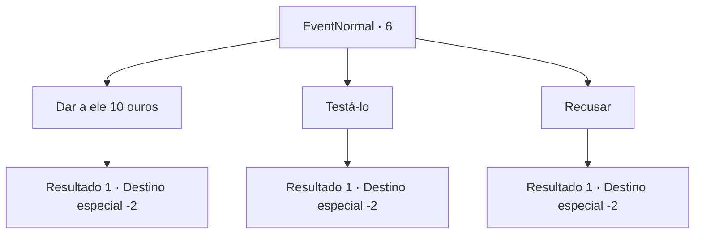

# Eventos normais · 6

[Índice da tabela](index.md) · [Índice geral](../index.md)

ID: `pt:EventNormal:6` · Fonte: `EventNormal4` · Versão: 1.2.47.

Mapeamento estático dos arquivos; a disponibilidade e a execução dependem do estado da run.

## Texto do evento

|drawing_begger|

 "Alguém ajude esta pobre alma cega!"

 Um velho com bandagens em volta dos olhos grita, sentado na esquina da rua. A cabeça dele se vira em diferentes direções, antes de se fixar em você. Ele gesticula e diz. 

 "Tem alguém aí? Por favor ajude!"


## Dados de entrada

```json
{
  "id": 6,
  "grade": 1,
  "place": "",
  "required": "5_7_0"
}
```

## Mapa das escolhas



## Escolhas e resultados

### Escolha 1

Dar a ele 10 ouros

Requisitos e outros campos da escolha:

```json
{
  "required": "1_4_10"
}
```

#### Resultado 1.1

Você dá ao pobre homem algum dinheiro.  

 "Obrigado! Muito obrigado!! Eu vou te retribuir algum dia."

  O cego se curva para agradecer.

Continuação registrada: [Destino especial `-2`](../destinos-especiais.md).

```json
{
  "required": "",
  "chance": "1",
  "nextEvent": -2,
  "type": 2,
  "reward": "0_3_2|0_4_-10|0_2_1"
}
```

### Escolha 2

Testá-lo

Requisitos e outros campos da escolha:

```json
{
  "required": "1_4_10"
}
```

#### Resultado 2.1

Você entrega ao pobre homem algum dinheiro. Ele se curva para agradecer. Então você se esconde e o observa à distância. 

 Pouco depois, ele olha em volta para se certificar de que ninguém está olhando. Em seguida, ele desamarra as bandagens dos olhos e começa a se afastar. Você o agarra e ele treme de medo. 

 "Eu, eu .. uh ..."

 Com as mãos trêmulas, ele devolve o seu dinheiro e foge.

Continuação registrada: [Destino especial `-2`](../destinos-especiais.md).

```json
{
  "required": "",
  "chance": "1",
  "nextEvent": -2,
  "type": 2,
  "reward": "0_2_1|5_7_1"
}
```

### Escolha 3

Recusar

Requisitos e outros campos da escolha:

```json
{
  "required": ""
}
```

#### Resultado 3.1

Você se recusa a ajudar.  Você o deixa para trás e vai embora.

Continuação registrada: [Destino especial `-2`](../destinos-especiais.md).

```json
{
  "required": "",
  "chance": "1",
  "nextEvent": -2,
  "type": 2,
  "reward": "0_3_-1"
}
```

## Referências que chegam a este evento

Nenhum `nextEvent` positivo da mesma tabela aponta para este nó. Isso não prova que seja inacessível: sorteio e estado de história podem selecioná-lo.

