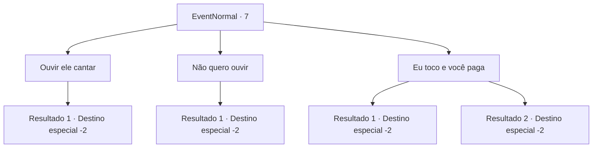

# Eventos normais · 7

[Índice da tabela](index.md) · [Índice geral](../index.md)

ID: `pt:EventNormal:7` · Fonte: `EventNormal4` · Versão: 1.2.47.

Mapeamento estático dos arquivos; a disponibilidade e a execução dependem do estado da run.

## Texto do evento

|drawing_bard|  Você conhece um bardo.  Ele se oferece para cantar por um pouco de dinheiro.

## Dados de entrada

```json
{
  "id": 7,
  "grade": 1,
  "place": "",
  "required": ""
}
```

## Mapa das escolhas



## Escolhas e resultados

### Escolha 1

Ouvir ele cantar

Requisitos e outros campos da escolha:

```json
{
  "required": "1_4_1"
}
```

#### Resultado 1.1

O bardo toca seu alaúde enquanto canta.  Você sente sua mente curar enquanto ouve.

Continuação registrada: [Destino especial `-2`](../destinos-especiais.md).

```json
{
  "required": "",
  "chance": "1",
  "nextEvent": -2,
  "type": 2,
  "reward": "0_1_1|0_4_-1|0_2_1"
}
```

### Escolha 2

Não quero ouvir

Requisitos e outros campos da escolha:

```json
{
  "required": ""
}
```

#### Resultado 2.1

Você recusa a oferta do bardo.  Ele se despede com um adeus.

Continuação registrada: [Destino especial `-2`](../destinos-especiais.md).

```json
{
  "required": "",
  "chance": "1",
  "nextEvent": -2,
  "type": 2,
  "reward": ""
}
```

### Escolha 3

Eu toco e você paga

Requisitos e outros campos da escolha:

```json
{
  "required": "1_4_2"
}
```

#### Resultado 3.1


 "Tudo bem. Mas você terá que pagar para usar meu alaúde, se eu não gostar da sua apresentação."

 Ele sorri e lhe entrega seu instrumento. Você mexe no alaúde, mas é muito difícil de tocar. O bardo pega de volta o instrumento depois de um tempo. Ele sai, dizendo que vai ver outra pessoa.

Continuação registrada: [Destino especial `-2`](../destinos-especiais.md).

```json
{
  "required": "",
  "chance": "20",
  "nextEvent": -2,
  "type": 1,
  "reward": "0_4_-2|0_2_1"
}
```

#### Resultado 3.2


 "Tudo bem. Mas você terá que pagar para usar meu alaúde, se eu não gostar da sua apresentação."

 Ele sorri e lhe entrega seu instrumento. Você se lembra de outros bardos se apresentando e começa a tocar. O bardo olha maravilhado. Quando você termina, ele bate palmas e lhe entrega algumas moedas de ouro. 

 "Esplêndido. Boa apresentação."

 Ele pega o alaúde e segue seu caminho.

Continuação registrada: [Destino especial `-2`](../destinos-especiais.md).

```json
{
  "required": "",
  "chance": "1|0_7_1",
  "nextEvent": -2,
  "type": 0,
  "reward": "0_2_1|0_4_2"
}
```

## Referências que chegam a este evento

Nenhum `nextEvent` positivo da mesma tabela aponta para este nó. Isso não prova que seja inacessível: sorteio e estado de história podem selecioná-lo.

