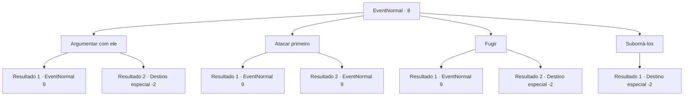

# Eventos normais · 8

[Índice da tabela](index.md) · [Índice geral](../index.md)

ID: `pt:EventNormal:8` · Fonte: `EventNormal4` · Versão: 1.2.47.

Mapeamento estático dos arquivos; a disponibilidade e a execução dependem do estado da run.

## Texto do evento

Um grupo de homens musculosos se aproxima de você.  Você vê um rosto familiar entre eles.  É o batedor de carteira que perdeu o pulso para você.  Ele contratou bandidos para se vingar.

## Dados de entrada

```json
{
  "id": 8,
  "grade": 1,
  "place": "",
  "required": "5_0_1"
}
```

## Mapa das escolhas



## Escolhas e resultados

### Escolha 1

Argumentar com ele

Requisitos e outros campos da escolha:

```json
{
  "required": "1_7_9"
}
```

#### Resultado 1.1

Você tenta argumentar com eles.  Mas eles não têm intenção de fazer isso.

Continuação registrada: [Evento 9](0009.md) na mesma tabela.

```json
{
  "required": "",
  "chance": "11",
  "nextEvent": 9,
  "type": 1,
  "reward": "6_0_24",
  "place": 4
}
```

#### Resultado 1.2

Eles estão muito impressionados com seu charme carismático para pensar direito, e logo voltam e vão embora.

Continuação registrada: [Destino especial `-2`](../destinos-especiais.md).

```json
{
  "required": "",
  "chance": "1|0_7_1",
  "nextEvent": -2,
  "type": 0,
  "reward": "0_2_1"
}
```

### Escolha 2

Atacar primeiro

Requisitos e outros campos da escolha:

```json
{
  "required": ""
}
```

#### Resultado 2.1

Você puxa sua arma para eles, mas erra. Eles zombam e avançam em você.

Continuação registrada: [Evento 9](0009.md) na mesma tabela.

```json
{
  "required": "",
  "chance": "4",
  "nextEvent": 9,
  "type": 1,
  "reward": "6_3_24",
  "place": 4
}
```

#### Resultado 2.2

Você puxa sua arma para eles. Quando um cai, os outros avançam em você.

Continuação registrada: [Evento 9](0009.md) na mesma tabela.

```json
{
  "required": "",
  "chance": "1|0_5_1",
  "nextEvent": 9,
  "type": 0,
  "reward": "6_2_24",
  "place": 4
}
```

### Escolha 3

Fugir

Requisitos e outros campos da escolha:

```json
{
  "required": ""
}
```

#### Resultado 3.1

Você corre o mais rápido que pode sem olhar para trás, mas eles o alcançam.

Continuação registrada: [Evento 9](0009.md) na mesma tabela.

```json
{
  "required": "",
  "chance": "8",
  "nextEvent": 9,
  "type": 1,
  "reward": "0_1_-1|6_0_24",
  "place": 4
}
```

#### Resultado 3.2

Você corre o mais rápido que pode sem olhar para trás. Eles não conseguem alcançá-lo.

Continuação registrada: [Destino especial `-2`](../destinos-especiais.md).

```json
{
  "required": "",
  "chance": "1|0_6_1",
  "nextEvent": -2,
  "type": 0,
  "reward": "0_1_-1|0_2_1"
}
```

### Escolha 4

Suborná-los

Requisitos e outros campos da escolha:

```json
{
  "required": "1_4_100"
}
```

#### Resultado 4.1

Você os suborna.  Os bandidos vão embora, com uma bolsa pesada de ouro, rindo.

Continuação registrada: [Destino especial `-2`](../destinos-especiais.md).

```json
{
  "required": "",
  "chance": "1",
  "nextEvent": -2,
  "type": 2,
  "reward": "0_4_-100|0_2_2"
}
```

## Referências que chegam a este evento

Nenhum `nextEvent` positivo da mesma tabela aponta para este nó. Isso não prova que seja inacessível: sorteio e estado de história podem selecioná-lo.

