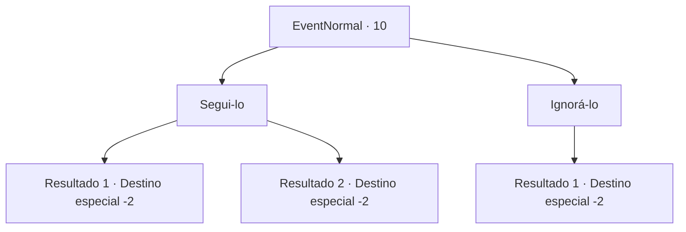

# Eventos normais · 10

[Índice da tabela](index.md) · [Índice geral](../index.md)

ID: `pt:EventNormal:10` · Fonte: `EventNormal4` · Versão: 1.2.47.

Mapeamento estático dos arquivos; a disponibilidade e a execução dependem do estado da run.

## Texto do evento

Você encontra uma borboleta, brilhando em um azul luminescente. Ela circula você como se estivesse te chamando para segui-la.

## Dados de entrada

```json
{
  "id": 10,
  "grade": 1,
  "place": "",
  "required": "5_131_0"
}
```

## Mapa das escolhas



## Escolhas e resultados

### Escolha 1

Segui-lo

Requisitos e outros campos da escolha:

```json
{
  "required": ""
}
```

#### Resultado 1.1

|drawing_pond| A borboleta luminescente o guia até um pequeno lago.  Você descansa e cura suas feridas lá.

Continuação registrada: [Destino especial `-2`](../destinos-especiais.md).

```json
{
  "required": "",
  "chance": "2",
  "nextEvent": -2,
  "type": 2,
  "reward": "0_0_1|0_1_1"
}
```

#### Resultado 1.2

Você tropeça ao tentar seguir a borboleta luminescente. Ela já se foi quando você se levanta.

Continuação registrada: [Destino especial `-2`](../destinos-especiais.md).

```json
{
  "required": "",
  "chance": "1",
  "nextEvent": -2,
  "type": 2,
  "reward": "0_0_-1|5_131_1"
}
```

### Escolha 2

Ignorá-lo

Requisitos e outros campos da escolha:

```json
{
  "required": ""
}
```

#### Resultado 2.1

Você ignora a borboleta luminescente.

Continuação registrada: [Destino especial `-2`](../destinos-especiais.md).

```json
{
  "required": "",
  "chance": "1",
  "nextEvent": -2,
  "type": 2,
  "reward": ""
}
```

## Referências que chegam a este evento

Nenhum `nextEvent` positivo da mesma tabela aponta para este nó. Isso não prova que seja inacessível: sorteio e estado de história podem selecioná-lo.

