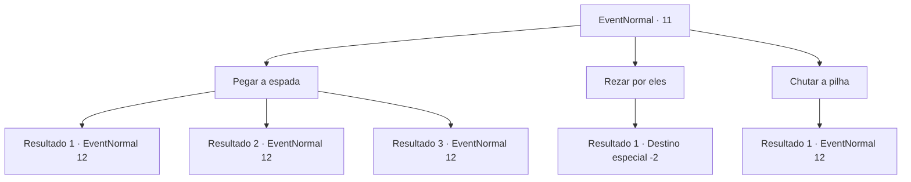

# Eventos normais · 11

[Índice da tabela](index.md) · [Índice geral](../index.md)

ID: `pt:EventNormal:11` · Fonte: `EventNormal4` · Versão: 1.2.47.

Mapeamento estático dos arquivos; a disponibilidade e a execução dependem do estado da run.

## Texto do evento

|drawing_skullAndSword| Você encontra as ruínas de um edifício que desabou. Ossos estão espalhados por toda parte, e uma espada está saindo de uma pilha deles.

## Dados de entrada

```json
{
  "id": 11,
  "grade": 1,
  "place": "",
  "required": ""
}
```

## Mapa das escolhas



## Escolhas e resultados

### Escolha 1

Pegar a espada

Requisitos e outros campos da escolha:

```json
{
  "required": ""
}
```

#### Resultado 1.1

No momento em que você pega a espada, os esqueletos próximos a ela surgem e o atacam.  Você os enfrenta com calma, apesar da emboscada.

Continuação registrada: [Evento 12](0012.md) na mesma tabela.

```json
{
  "required": "",
  "chance": "1|0_14_1",
  "nextEvent": 12,
  "type": 0,
  "reward": "6_0_12",
  "place": 13
}
```

#### Resultado 1.2

No momento em que você pega a espada, os esqueletos próximos a ela surgem e o atacam.  Você quase teve um ataque cardíaco.  Você estende sua arma com as mãos trêmulas.

Continuação registrada: [Evento 12](0012.md) na mesma tabela.

```json
{
  "required": "1_1_2",
  "chance": "7",
  "nextEvent": 12,
  "type": 1,
  "reward": "0_1_-1|6_0_12",
  "place": 13
}
```

#### Resultado 1.3

No momento em que você pega a espada, os esqueletos próximos a ela surgem e o atacam. Você quase teve um ataque cardíaco.

Continuação registrada: [Evento 12](0012.md) na mesma tabela.

```json
{
  "required": "2_1_2",
  "chance": "7",
  "nextEvent": 12,
  "type": 1,
  "reward": "0_1_-1|6_0_12",
  "place": 13
}
```

### Escolha 2

Rezar por eles

Requisitos e outros campos da escolha:

```json
{
  "required": ""
}
```

#### Resultado 2.1

Você encara a pilha de ossos e reza para que suas almas descansem em paz.  O vento seco sopra pelo monte, mas nada mais acontece.  Você termina suas orações e continua sua jornada.

Continuação registrada: [Destino especial `-2`](../destinos-especiais.md).

```json
{
  "required": "",
  "chance": "1",
  "nextEvent": -2,
  "type": 2,
  "reward": "0_3_1"
}
```

### Escolha 3

Chutar a pilha

Requisitos e outros campos da escolha:

```json
{
  "required": ""
}
```

#### Resultado 3.1

Você chuta a pilha de ossos.  Esqueletos surgem e atacam você.

Continuação registrada: [Evento 12](0012.md) na mesma tabela.

```json
{
  "required": "",
  "chance": "1",
  "nextEvent": 12,
  "type": 2,
  "reward": "6_3_12",
  "place": 13
}
```

## Referências que chegam a este evento

Nenhum `nextEvent` positivo da mesma tabela aponta para este nó. Isso não prova que seja inacessível: sorteio e estado de história podem selecioná-lo.

