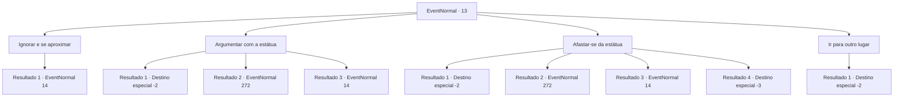

# Eventos normais · 13

[Índice da tabela](index.md) · [Índice geral](../index.md)

ID: `pt:EventNormal:13` · Fonte: `EventNormal4` · Versão: 1.2.47.

Mapeamento estático dos arquivos; a disponibilidade e a execução dependem do estado da run.

## Texto do evento

|drawing_fortress| Você encontra uma fortaleza abandonada no topo de um penhasco. Vinhas cobrem suas paredes, e grama tão alta quanto sua cintura rodeia a fortaleza. Lá dentro, uma estátua decorativa fala com você. 

 "Aviso. Vá mais longe e sua sobrevivência pode não ser garantida."


## Dados de entrada

```json
{
  "id": 13,
  "grade": 1,
  "place": "",
  "required": "5_195_0"
}
```

## Mapa das escolhas



## Escolhas e resultados

### Escolha 1

Ignorar e se aproximar

Requisitos e outros campos da escolha:

```json
{
  "required": ""
}
```

#### Resultado 1.1

Você ignora a estátua e entra na fortaleza.  A estátua se levanta e dá um passo à sua frente.  

 "Exterminando invasor."


Continuação registrada: [Evento 14](0014.md) na mesma tabela.

```json
{
  "required": "",
  "chance": "1",
  "nextEvent": 14,
  "type": 2,
  "reward": "6_0_37",
  "place": 7
}
```

### Escolha 2

Argumentar com a estátua 

Requisitos e outros campos da escolha:

```json
{
  "required": "1_7_9"
}
```

#### Resultado 2.1

A estátua é convencida pelo seu charme carismático e pela sua lábia.  A estátua se move silenciosamente para o lado e permite que você entre.  Você faz uma busca completa na fortaleza. Você encontra um manequim de madeira vestindo uma armadura escondido bem no fundo de uma das câmaras.  A armadura está enferrujada nas bordas, mas ainda pode ser usada.

Continuação registrada: [Destino especial `-2`](../destinos-especiais.md).

```json
{
  "required": "",
  "chance": "1|0_12_1",
  "nextEvent": -2,
  "type": 0,
  "reward": "0_1_1|0_2_1|3_32_1|5_195_1"
}
```

#### Resultado 2.2

Sua habilidade de fala e carisma é suficiente para convencer a estátua.  Ela se move silenciosamente para o lado, deixando você entrar na fortaleza.  Você faz uma busca completa na fortaleza. Você encontra um baú de tesouro escondido, que se encontrava ao lado de uma parede desmoronada.

Continuação registrada: [Evento 272](0272.md) na mesma tabela.

```json
{
  "required": "",
  "chance": "1|0_12_1",
  "nextEvent": 272,
  "type": 0,
  "reward": "0_2_1"
}
```

#### Resultado 2.3

Você tenta convencer a estátua a deixá-lo entrar.  Mas a estátua não tem intenção de ouvir.  

 "Exterminando invasor."


Continuação registrada: [Evento 14](0014.md) na mesma tabela.

```json
{
  "required": "",
  "chance": "35",
  "nextEvent": 14,
  "type": 1,
  "reward": "6_0_37",
  "place": 7
}
```

### Escolha 3

Afastar-se da estátua

Requisitos e outros campos da escolha:

```json
{
  "required": ""
}
```

#### Resultado 3.1

Você descobre a fórmula mágica que alimenta a estátua.  Você concentra sua mente e destrói a fórmula, a estátua desmorona como uma marionete solta de seus fios.  Você faz uma busca completa na fortaleza. Você encontra um manequim de madeira vestindo uma armadura escondido bem no fundo de uma das câmaras.  A armadura está enferrujada nas bordas, mas ainda pode ser usada.

Continuação registrada: [Destino especial `-2`](../destinos-especiais.md).

```json
{
  "required": "",
  "chance": "1|0_7_1",
  "nextEvent": -2,
  "type": 0,
  "reward": "0_2_1|3_32_1|5_195_1"
}
```

#### Resultado 3.2

Você descobre a fórmula mágica que alimenta a estátua.  Você concentra sua mente e destrói a fórmula, a estátua desmorona como uma marionete solta de seus fios.  Você faz uma busca completa na fortaleza. Você encontra um baú de tesouro escondido, que se encontrava ao lado de uma parede desmoronada.

Continuação registrada: [Evento 272](0272.md) na mesma tabela.

```json
{
  "required": "",
  "chance": "1|0_7_1",
  "nextEvent": 272,
  "type": 0,
  "reward": "0_2_1"
}
```

#### Resultado 3.3

Você não consegue descobrir a fórmula mágica que alimenta a estátua.  Você tenta focar sua mente quando a magia da estátua reage e o ataca de volta.  Você está com uma dor de cabeça terrível e a estátua se aproxima e fala.  

 "Exterminando invasor."


Continuação registrada: [Evento 14](0014.md) na mesma tabela.

```json
{
  "required": "1_1_2",
  "chance": "22",
  "nextEvent": 14,
  "type": 1,
  "reward": "0_1_-1|6_0_37|0_2_1",
  "place": 7
}
```

#### Resultado 3.4

Você não consegue descobrir a fórmula mágica que alimenta a estátua.  Você tenta focar sua mente quando a magia da estátua reage e o ataca de volta.  Você tem uma terrível dor de cabeça e desmaia.

Continuação registrada: [Destino especial `-3`](../destinos-especiais.md).

```json
{
  "required": "2_1_2",
  "chance": "22",
  "nextEvent": -3,
  "type": 1,
  "reward": "0_1_-1"
}
```

### Escolha 4

Ir para outro lugar

Requisitos e outros campos da escolha:

```json
{
  "required": ""
}
```

#### Resultado 4.1

Você encara a fortaleza, sem fazer nada.  Então você se afasta dela.

Continuação registrada: [Destino especial `-2`](../destinos-especiais.md).

```json
{
  "required": "",
  "chance": "1",
  "nextEvent": -2,
  "type": 2,
  "reward": ""
}
```

## Referências que chegam a este evento

Nenhum `nextEvent` positivo da mesma tabela aponta para este nó. Isso não prova que seja inacessível: sorteio e estado de história podem selecioná-lo.

