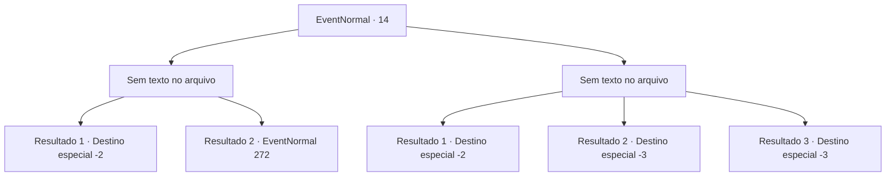

# Eventos normais · 14

[Índice da tabela](index.md) · [Índice geral](../index.md)

ID: `pt:EventNormal:14` · Fonte: `EventNormal4` · Versão: 1.2.47.

Mapeamento estático dos arquivos; a disponibilidade e a execução dependem do estado da run.

## Texto do evento

*Sem texto no arquivo.*

## Dados de entrada

```json
{
  "id": 14,
  "grade": 1,
  "place": "",
  "required": ""
}
```

## Mapa das escolhas



## Escolhas e resultados

### Escolha 1

*Sem texto no arquivo; o papel dessa opção depende da interface do jogo.*

Requisitos e outros campos da escolha:

```json
{
  "required": ""
}
```

#### Resultado 1.1

Você destrói a estátua e faz uma busca completa na fortaleza.  Você encontra um manequim de madeira vestindo uma armadura escondido bem no fundo de uma das câmaras.  A armadura está enferrujada nas bordas, mas ainda pode ser usada.

Continuação registrada: [Destino especial `-2`](../destinos-especiais.md).

```json
{
  "required": "",
  "chance": "1",
  "nextEvent": -2,
  "type": 2,
  "reward": "3_32_1"
}
```

#### Resultado 1.2

Você quebra a estátua em pedaços e conduz uma busca completa na fortaleza. Você encontra um baú de tesouro escondido próximo a uma parede desmoronada.

Continuação registrada: [Evento 272](0272.md) na mesma tabela.

```json
{
  "required": "",
  "chance": "1",
  "nextEvent": 272,
  "type": 2,
  "reward": ""
}
```

### Escolha 2

*Sem texto no arquivo; o papel dessa opção depende da interface do jogo.*

Requisitos e outros campos da escolha:

```json
{
  "required": ""
}
```

#### Resultado 2.1

A estátua bate em você e o expulsa.

Continuação registrada: [Destino especial `-2`](../destinos-especiais.md).

```json
{
  "required": "1_0_2|1_1_2",
  "chance": "1",
  "nextEvent": -2,
  "type": 2,
  "reward": "0_0_-1|0_1_-1"
}
```

#### Resultado 2.2

Você paga com sua vida por ignorar o aviso.

Continuação registrada: [Destino especial `-3`](../destinos-especiais.md).

```json
{
  "required": "2_0_2",
  "chance": "1",
  "nextEvent": -3,
  "type": 2,
  "reward": "0_0_-1|0_1_-1"
}
```

#### Resultado 2.3

Você paga com sua vida por ignorar o aviso.

Continuação registrada: [Destino especial `-3`](../destinos-especiais.md).

```json
{
  "required": "2_1_2",
  "chance": "1",
  "nextEvent": -3,
  "type": 2,
  "reward": "0_0_-1|0_1_-1"
}
```

## Referências que chegam a este evento

- [Evento 13 · escolha 1 · resultado 1](0013.md#escolha-1)
- [Evento 13 · escolha 2 · resultado 3](0013.md#escolha-2)
- [Evento 13 · escolha 3 · resultado 3](0013.md#escolha-3)
