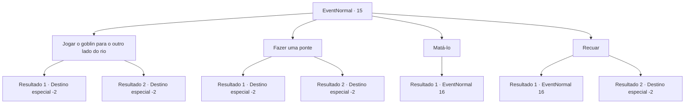

# Eventos normais · 15

[Índice da tabela](index.md) · [Índice geral](../index.md)

ID: `pt:EventNormal:15` · Fonte: `EventNormal4` · Versão: 1.2.47.

Mapeamento estático dos arquivos; a disponibilidade e a execução dependem do estado da run.

## Texto do evento

Você encontra um goblin encarando um rio inundado. Ele fica surpreso ao ver você e fala. 

 "Eu, quero atravessar. Água assustadora, humano ajuda, eu ajudo."


## Dados de entrada

```json
{
  "id": 15,
  "grade": 1,
  "place": "",
  "required": ""
}
```

## Mapa das escolhas



## Escolhas e resultados

### Escolha 1

Jogar o goblin para o outro lado do rio

Requisitos e outros campos da escolha:

```json
{
  "required": ""
}
```

#### Resultado 1.1

Você joga o goblin o mais forte que pode.  Mas você não é forte o suficiente e ele cai no rio.  O rio leva tudo embora.

Continuação registrada: [Destino especial `-2`](../destinos-especiais.md).

```json
{
  "required": "",
  "chance": "8",
  "nextEvent": -2,
  "type": 1,
  "reward": "0_2_1"
}
```

#### Resultado 1.2

Você joga o goblin o mais forte que pode.  Você é forte o suficiente e ele cai do outro lado.  No entanto, ele foge assim que pousa.

Continuação registrada: [Destino especial `-2`](../destinos-especiais.md).

```json
{
  "required": "",
  "chance": "1|0_5_1",
  "nextEvent": -2,
  "type": 0,
  "reward": "0_2_1|0_3_2"
}
```

### Escolha 2

Fazer uma ponte

Requisitos e outros campos da escolha:

```json
{
  "required": "1_0_2"
}
```

#### Resultado 2.1

Sem pensar muito, você cortou uma árvore próxima. A árvore cai na direção do goblin. Você deixa o cadáver do goblin para trás e continua sua jornada.

Continuação registrada: [Destino especial `-2`](../destinos-especiais.md).

```json
{
  "required": "",
  "chance": "4",
  "nextEvent": -2,
  "type": 1,
  "reward": "0_0_-1"
}
```

#### Resultado 2.2

Você faz uma ponte com uma árvore alta que você corta.  O goblin cruza o rio, agradece e lhe dá ouro antes que vá embora.

Continuação registrada: [Destino especial `-2`](../destinos-especiais.md).

```json
{
  "required": "",
  "chance": "1|0_7_1",
  "nextEvent": -2,
  "type": 0,
  "reward": "0_2_1|0_4_1"
}
```

### Escolha 3

Matá-lo

Requisitos e outros campos da escolha:

```json
{
  "required": ""
}
```

#### Resultado 3.1

Você decide matar o goblin.  Ele percebe e rapidamente saca sua arma.

Continuação registrada: [Evento 16](0016.md) na mesma tabela.

```json
{
  "required": "",
  "chance": "1",
  "nextEvent": 16,
  "type": 2,
  "reward": "6_0_1",
  "place": 1
}
```

### Escolha 4

Recuar

Requisitos e outros campos da escolha:

```json
{
  "required": ""
}
```

#### Resultado 4.1

Você decide ignorar o goblin e ir para outro lugar.  O goblin enfurecido avança contra você.

Continuação registrada: [Evento 16](0016.md) na mesma tabela.

```json
{
  "required": "",
  "chance": "8",
  "nextEvent": 16,
  "type": 2,
  "reward": "6_0_1",
  "place": 1
}
```

#### Resultado 4.2

Você ignora o goblin e segue para outro lugar.  O goblin murmura algo que você não consegue ouvir.

Continuação registrada: [Destino especial `-2`](../destinos-especiais.md).

```json
{
  "required": "",
  "chance": "1|0_12_1",
  "nextEvent": -2,
  "type": 2,
  "reward": ""
}
```

## Referências que chegam a este evento

Nenhum `nextEvent` positivo da mesma tabela aponta para este nó. Isso não prova que seja inacessível: sorteio e estado de história podem selecioná-lo.

