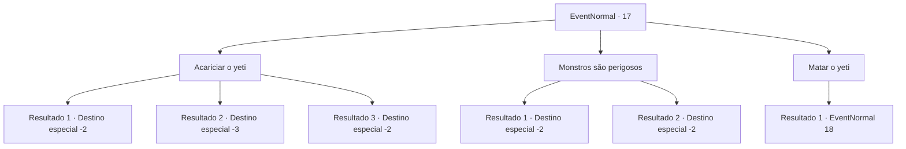

# Eventos normais · 17

[Índice da tabela](index.md) · [Índice geral](../index.md)

ID: `pt:EventNormal:17` · Fonte: `EventNormal4` · Versão: 1.2.47.

Mapeamento estático dos arquivos; a disponibilidade e a execução dependem do estado da run.

## Texto do evento

Um menino está jogando frutinhas para um yeti, que come todas elas. Yetis são feras perigosas conhecidas por atacar aventureiros. O menino está brincando com um sorriso muito inocente. Conforme você se aproxima, ele pergunta a você. 

 "Aventureiro! Este é o meu amigo! Ele não é fofo? Faça carinho nele!"


## Dados de entrada

```json
{
  "id": 17,
  "grade": 1,
  "place": "",
  "required": "5_583_0"
}
```

## Mapa das escolhas



## Escolhas e resultados

### Escolha 1

Acariciar o yeti

Requisitos e outros campos da escolha:

```json
{
  "required": ""
}
```

#### Resultado 1.1

Você estende a mão para acariciar o yeti. De repente, o yeti lhe dá um tapa na cabeça.  O menino pula e repreende o yeti.  Então o menino lhe dá uma poção.  

 "Eu sinto muito! Por favor, tome isso como um sinal de desculpas! Mamãe diz que é caro. Nunu geralmente não é assim ..."

  O menino sai com o Yeti.

Continuação registrada: [Destino especial `-2`](../destinos-especiais.md).

```json
{
  "required": "1_0_2",
  "chance": "13",
  "nextEvent": -2,
  "type": 1,
  "reward": "0_0_-1|3_37_1|0_2_1|5_583_1"
}
```

#### Resultado 1.2

Você estende a mão para acariciar o yeti.  De repente, o yeti lhe dá um tapa na cabeça.  Você desmaia.

Continuação registrada: [Destino especial `-3`](../destinos-especiais.md).

```json
{
  "required": "2_0_2",
  "chance": "13",
  "nextEvent": -3,
  "type": 1,
  "reward": "0_0_-1"
}
```

#### Resultado 1.3

Você estende a mão para acariciar o yeti.  O yeti ronrona, aparentemente satisfeito.  O menino fica animado e abraça o yeti.  Em seguida, ele lhe entrega algumas frutas.  

 "Obrigado por ser legal com Nunu!"

  Com o doce sabor dos frutos silvestres na boca, você continua sua jornada.

Continuação registrada: [Destino especial `-2`](../destinos-especiais.md).

```json
{
  "required": "",
  "chance": "1|0_12_1",
  "nextEvent": -2,
  "type": 0,
  "reward": "0_2_1|0_1_1|5_583_1"
}
```

### Escolha 2

Monstros são perigosos

Requisitos e outros campos da escolha:

```json
{
  "required": ""
}
```

#### Resultado 2.1


 "O que você sabe sobre Nunu! Ele não é nem um pouco perigoso!"

 O menino fica chateado e vai embora. O yeti segue ele.

Continuação registrada: [Destino especial `-2`](../destinos-especiais.md).

```json
{
  "required": "11_0_0",
  "chance": "1",
  "nextEvent": -2,
  "type": 2,
  "reward": "0_3_1|5_583_1"
}
```

#### Resultado 2.2


 "O que você sabe sobre Nunu! Ele não é nem um pouco perigoso!"

  O menino fica chateado e vai embora. O yeti segue ele.

Continuação registrada: [Destino especial `-2`](../destinos-especiais.md).

```json
{
  "required": "11_0_1",
  "chance": "1",
  "nextEvent": -2,
  "type": 2,
  "reward": "0_3_1|5_583_1"
}
```

### Escolha 3

Matar o yeti

Requisitos e outros campos da escolha:

```json
{
  "required": ""
}
```

#### Resultado 3.1

Eventualmente, você pensa, a besta comerá o menino.  Você decide matá-lo.

Continuação registrada: [Evento 18](0018.md) na mesma tabela.

```json
{
  "required": "",
  "chance": "1",
  "nextEvent": 18,
  "type": 2,
  "reward": "6_0_18|5_583_1",
  "place": 9
}
```

## Referências que chegam a este evento

Nenhum `nextEvent` positivo da mesma tabela aponta para este nó. Isso não prova que seja inacessível: sorteio e estado de história podem selecioná-lo.

